# Database schema overview, 2026-10-28

Audit of the SQL schema of Studio, read from source only. No live database was opened.

Sources read, all under `workspaces/runtime/packages/`:

- `runtime-store/src/runtime-state-schema.json`: the fresh-state catalog. `fresh_state.rs` uses it to create `canvas.sqlite3` and `analytics.sqlite3`. This is the only source of the core tables (agents, events, items, tasks, monitors, requests, rooms).
- `runtime-store/src/sync_schema.sql`: sync tables, event and transcript triggers.
- `runtime-store/src/feature_schema.rs`: feature tables created at startup or on first use.
- `runtime-store/src/supervisor_schema.sql` and `supervisor_journal.rs`: `supervisor.sqlite3`.
- `runtime-store/src/migrations/`, `agent_columns.rs`, `agent_volatile.rs`, `entity_publication.rs`, `stored_text_*.rs`, `repositories/*` (named index and trigger definitions).
- `runtime-store/src/repositories/cost_aggregate.rs` and `runtime-services/src/analytics_capture.rs` (analytics tables).

Notes on reading this document:

- There are no `FOREIGN KEY` or `REFERENCES` clauses in any schema. All links in the diagrams are inferred from column names and code joins.
- Most tables store a JSON `record` column and a few typed columns. Typed columns are the ones used in joins and indexes.
- `runtime-state-schema.json` is older than the code in some places. It lacks the `sync_entity_scope_*` triggers, `sync_identity`, `sync_generation` and the newer agent index names. The counts below merge the snapshot with the code.
- A fourth database, `host-exec.sqlite3` (tables `receipts`, `events`), lives in the guest host-exec service (`runtime-services/src/host_exec_service/mod.rs`). It is outside the three databases and not counted.

## 1. All tables

Group names match section 2. "Creator" is the file that creates the table.

| Table                                     | Database   | Group                       | Key columns                                                   | Purpose                                                                                                                   | Creator                                                                   |
| ----------------------------------------- | ---------- | --------------------------- | ------------------------------------------------------------- | ------------------------------------------------------------------------------------------------------------------------- | ------------------------------------------------------------------------- |
| `runtime_agents`                          | canvas     | agents and turns            | id; record JSON; generated columns                            | One row per agent (chat, worker, reviewer). Record holds status, parent, root, account, thread, turn, epoch, queue state. | runtime-state-schema.json (fresh_state.rs); columns in agent_columns.rs   |
| `runtime_agent_volatile`                  | canvas     | agents and turns            | id (= agent id)                                               | Hot agent fields moved out of the record: events, activity, tail, token counters.                                         | agent_volatile.rs                                                         |
| `runtime_agent_record_generation`         | canvas     | agents and turns            | id=1; value                                                   | Counter bumped by agent triggers. Change journal for agent records.                                                       | runtime-state-schema.json (fresh_state.rs)                                |
| `runtime_agent_moves`                     | canvas     | agents and turns            | id; record                                                    | Agent move between servers or workspaces, one row per move.                                                               | feature_schema.rs (also snapshot)                                         |
| `runtime_execution_runs`                  | canvas     | agents and turns            | id; agent, account, epoch, thread, turn, created              | One provider run (turn attempt group) for an agent.                                                                       | feature_schema.rs (also snapshot)                                         |
| `runtime_execution_attempts`              | canvas     | agents and turns            | id; run                                                       | One attempt inside a run.                                                                                                 | feature_schema.rs (also snapshot)                                         |
| `runtime_execution_inputs`                | canvas     | agents and turns            | (run, event)                                                  | Which user events a run consumed.                                                                                         | feature_schema.rs (also snapshot)                                         |
| `runtime_execution_effects`               | canvas     | agents and turns            | id; run, kind, reference                                      | Side effects recorded for a run.                                                                                          | feature_schema.rs (also snapshot)                                         |
| `runtime_execution_nodes`                 | canvas     | agents and turns            | id; run                                                       | Execution graph nodes of a run.                                                                                           | feature_schema.rs (also snapshot)                                         |
| `runtime_completed_turns`                 | canvas     | agents and turns            | id (turn id)                                                  | Set of turns that completed. Used to avoid double completion.                                                             | runtime-state-schema.json (fresh_state.rs)                                |
| `runtime_compactions`                     | canvas     | agents and turns            | id; agent                                                     | Context compaction markers per agent.                                                                                     | runtime-state-schema.json (fresh_state.rs)                                |
| `runtime_context_manifests`               | canvas     | agents and turns            | (agent, thread_id, compactions); sequence, event_id           | Context manifest per compaction of a thread.                                                                              | runtime-state-schema.json (fresh_state.rs)                                |
| `runtime_context_reminders`               | canvas     | agents and turns            | (agent, version); event_id                                    | Context reminder already sent per agent and version.                                                                      | runtime-state-schema.json (fresh_state.rs)                                |
| `runtime_budget`                          | canvas     | agents and turns            | id; record                                                    | Historical budget state and replay diagnostics (kept for old data).                                                       | feature_schema.rs (also snapshot)                                         |
| `runtime_events`                          | canvas     | events and messages         | id; agent, kind, status, created, epoch, turn_id, error, text | Every user, assistant and system event of an agent. Status queued means waiting in the queue.                             | runtime-state-schema.json (fresh_state.rs)                                |
| `runtime_event_meta`                      | canvas     | events and messages         | id (= event id); record                                       | Event metadata: rootId, leadId, transcriptItemId, assets.                                                                 | feature_schema.rs (also snapshot)                                         |
| `runtime_chat_messages`                   | canvas     | events and messages         | seq; id UNIQUE; room, sender, created, deliveries             | Chat room messages between agents.                                                                                        | runtime-state-schema.json (fresh_state.rs)                                |
| `runtime_rooms`                           | canvas     | events and messages         | id; record (members, rootId)                                  | Chat room definition and members.                                                                                         | runtime-state-schema.json (fresh_state.rs)                                |
| `runtime_requests`                        | canvas     | events and messages         | id; record (agent, status)                                    | Questions and approval requests shown to the user.                                                                        | runtime-state-schema.json (fresh_state.rs)                                |
| `runtime_complaints`                      | canvas     | events and messages         | id; record (leadId)                                           | Complaints raised by agents or the user.                                                                                  | runtime-state-schema.json (fresh_state.rs)                                |
| `runtime_native_notices`                  | canvas     | events and messages         | id; record                                                    | Notices received from the native provider.                                                                                | feature_schema.rs                                                         |
| `runtime_items`                           | canvas     | transcript                  | id; agent, created, record                                    | Transcript items (messages, tool calls) per agent.                                                                        | runtime-state-schema.json (fresh_state.rs)                                |
| `runtime_item_fulltext`                   | canvas     | transcript                  | id (= item id); body                                          | Plain text body of an item for search.                                                                                    | feature_schema.rs (also snapshot)                                         |
| `runtime_search_next`                     | canvas     | transcript                  | FTS5 rowid; body                                              | Contentless full text index of item bodies.                                                                               | feature_schema.rs                                                         |
| `runtime_search_next_meta`                | canvas     | transcript                  | id; agent, kind, search_rowid UNIQUE                          | Maps an item to its FTS5 rowid.                                                                                           | feature_schema.rs (also snapshot)                                         |
| `runtime_search_rollout`                  | canvas     | transcript                  | id=1; phase, cursor                                           | Progress of the search index rollout.                                                                                     | feature_schema.rs (also snapshot)                                         |
| `runtime_transcript_revisions`            | canvas     | transcript                  | agent; revision                                               | Revision counter per agent transcript. Bumped by triggers on agents and items.                                            | sync_schema.sql                                                           |
| `sync_identity`                           | canvas     | sync                        | id                                                            | Random identity of this sync store.                                                                                       | sync_schema.sql                                                           |
| `sync_generation`                         | canvas     | sync                        | id=1; value                                                   | Sync generation number.                                                                                                   | sync_schema.sql                                                           |
| `sync_documents`                          | canvas     | sync                        | seq; (scope, id) UNIQUE; payload, deleted                     | Older document-style sync rows with sequence number.                                                                      | sync_schema.sql (also snapshot)                                           |
| `sync_entities`                           | canvas     | sync                        | (collection, id); seq, hash, payload, deleted                 | Current sync entity rows. Server sends them as SSE deltas. Tombstones keep deleted=1.                                     | sync_schema.sql (also snapshot)                                           |
| `sync_entity_meta`                        | canvas     | sync                        | key; value                                                    | Counters and visibility keys for sync (tombstone count, event window seq).                                                | sync_schema.sql (also snapshot)                                           |
| `sync_versions`                           | canvas     | sync                        | seq; scope UNIQUE; hash, deleted, updated                     | Version per sync scope.                                                                                                   | sync_schema.sql (also snapshot)                                           |
| `runtime_operation_receipts`              | canvas     | receipts and idempotency    | id; signature, result                                         | Generic receipt for a request or workflow step. Id has a namespace prefix.                                                | feature_schema.rs (also snapshot)                                         |
| `runtime_lead_requests`                   | canvas     | receipts and idempotency    | id; agent, signature                                          | Alias from a create request id to the agent it created.                                                                   | feature_schema.rs (also snapshot)                                         |
| `runtime_tool_requests`                   | canvas     | receipts and idempotency    | id; record (agent, updated)                                   | Tool call requests from agents with their results state.                                                                  | feature_schema.rs (also snapshot)                                         |
| `runtime_tool_request_aliases`            | canvas     | receipts and idempotency    | (agent, alias, request)                                       | Alias ids for a tool request.                                                                                             | feature_schema.rs (also snapshot)                                         |
| `runtime_tool_results`                    | canvas     | receipts and idempotency    | id; result                                                    | Stored tool results by request id.                                                                                        | feature_schema.rs (also snapshot)                                         |
| `runtime_native_action_receipts`          | canvas     | receipts and idempotency    | id; signature, receipt, outcome                               | Receipt of a native provider action.                                                                                      | feature_schema.rs                                                         |
| `runtime_context_terminal_receipts`       | canvas     | receipts and idempotency    | id; agent, operation, record                                  | Receipt of a context repair terminal step.                                                                                | feature_schema.rs                                                         |
| `runtime_process_actions`                 | canvas     | receipts and idempotency    | id; signature, record                                         | Process stop or signal action with phase and result.                                                                      | feature_schema.rs                                                         |
| `runtime_limit_reset_requests`            | canvas     | receipts and idempotency    | id; attempt_id                                                | Binds a public reset request id to one reset attempt.                                                                     | feature_schema.rs                                                         |
| `runtime_limit_reset_attempts`            | canvas     | receipts and idempotency    | id; record                                                    | Credit redemption attempts for rate limit resets.                                                                         | feature_schema.rs                                                         |
| `runtime_safety_retries`                  | canvas     | receipts and idempotency    | id; record                                                    | Journal of safety buffering retry requests.                                                                               | feature_schema.rs                                                         |
| `user_terminal_receipts`                  | canvas     | receipts and idempotency    | id; signature, result                                         | Receipt of a terminal command.                                                                                            | feature_schema.rs                                                         |
| `runtime_scheduler_agent_changes`         | canvas     | queue and scheduling        | id (agent); generation                                        | Agents changed since a scheduler generation.                                                                              | runtime-state-schema.json (fresh_state.rs)                                |
| `runtime_scheduler_agent_change_state`    | canvas     | queue and scheduling        | id=1; floor, generation, entries, total                       | State of the scheduler change log.                                                                                        | runtime-state-schema.json (fresh_state.rs)                                |
| `runtime_capacity_retries`                | canvas     | queue and scheduling        | id; agent, record                                             | Retry after provider capacity refusal.                                                                                    | feature_schema.rs (also snapshot)                                         |
| `runtime_usage_resumes`                   | canvas     | queue and scheduling        | id; agent, record                                             | Resume of an agent after a usage limit.                                                                                   | feature_schema.rs (also snapshot)                                         |
| `runtime_rules`                           | canvas     | queue and scheduling        | id; record (agent, status, inFlight)                          | Wake rules evaluated by the rule tick.                                                                                    | feature_schema.rs (also snapshot)                                         |
| `runtime_monitors`                        | canvas     | queue and scheduling        | id; record (agent, status)                                    | Monitors that watch agents and wake them.                                                                                 | runtime-state-schema.json (fresh_state.rs)                                |
| `runtime_tasks`                           | canvas     | queue and scheduling        | id; record (agent, status)                                    | Task list items.                                                                                                          | runtime-state-schema.json (fresh_state.rs)                                |
| `runtime_server_outbox`                   | canvas     | multi-server and federation | id; server, state, next_at, fingerprint                       | Commands queued for a paired server.                                                                                      | feature_schema.rs (also snapshot)                                         |
| `runtime_server_inbox`                    | canvas     | multi-server and federation | id; signature, state, principal, actor                        | Commands received from a paired server.                                                                                   | feature_schema.rs (also snapshot)                                         |
| `runtime_server_links`                    | canvas     | multi-server and federation | id; record (side, parent)                                     | Link between a local agent and a remote worker.                                                                           | feature_schema.rs (also snapshot)                                         |
| `runtime_server_fetch`                    | canvas     | multi-server and federation | id; server, signature, state                                  | Cross server fetch request state.                                                                                         | feature_schema.rs (also snapshot)                                         |
| `runtime_server_retired`                  | canvas     | multi-server and federation | (id, direction); server, actor                                | Retired request ids kept to refuse replay.                                                                                | feature_schema.rs (also snapshot)                                         |
| `runtime_server_output_tools`             | canvas     | multi-server and federation | id; expires                                                   | Short lived output tool grants.                                                                                           | feature_schema.rs (also snapshot)                                         |
| `runtime_server_exec`                     | canvas     | multi-server and federation | id; owner, actor                                              | Remote command execution request.                                                                                         | feature_schema.rs                                                         |
| `runtime_server_exec_audit`               | canvas     | multi-server and federation | id; actor, source_server, server, argv_hash                   | Audit of remote command execution.                                                                                        | feature_schema.rs                                                         |
| `runtime_server_exec_input`               | canvas     | multi-server and federation | id; handle                                                    | Input channel handle of a remote execution.                                                                               | feature_schema.rs                                                         |
| `runtime_federation_settings`             | canvas     | multi-server and federation | id; record                                                    | Federation settings.                                                                                                      | feature_schema.rs (also snapshot)                                         |
| `runtime_federation_identity`             | canvas     | multi-server and federation | id; record                                                    | Federation identity keys.                                                                                                 | feature_schema.rs (also snapshot)                                         |
| `runtime_federation_peers`                | canvas     | multi-server and federation | id; record                                                    | Federation peers.                                                                                                         | feature_schema.rs (also snapshot)                                         |
| `runtime_federation_invites`              | canvas     | multi-server and federation | id; record                                                    | Federation invites.                                                                                                       | feature_schema.rs (also snapshot)                                         |
| `runtime_federation_rooms`                | canvas     | multi-server and federation | id; record                                                    | Federation shared rooms.                                                                                                  | feature_schema.rs (also snapshot)                                         |
| `runtime_federation_outbox`               | canvas     | multi-server and federation | id; peer_id                                                   | Federation messages waiting for delivery.                                                                                 | feature_schema.rs (also snapshot)                                         |
| `runtime_federation_inbox`                | canvas     | multi-server and federation | (peer_id, message_id)                                         | Federation messages already received.                                                                                     | feature_schema.rs (also snapshot)                                         |
| `runtime_federation_nonces`               | canvas     | multi-server and federation | (peer_id, nonce); created                                     | Replay protection nonces for federation peers.                                                                            | feature_schema.rs (also snapshot)                                         |
| `runtime_peer_update_settings`            | canvas     | multi-server and federation | id=1; auto_update                                             | Auto update setting for peer updates. No creating code found (see notes).                                                 | none: read in runtime-services/src/multi_server.rs, created only in tests |
| `runtime_workspace_operations`            | canvas     | workspaces and work         | id; record (phase, agent)                                     | Workspace operation (create, merge, retain) with phase.                                                                   | feature_schema.rs (also snapshot)                                         |
| `runtime_work`                            | canvas     | workspaces and work         | id; record (owner, rootId, status)                            | Work items assigned to agents.                                                                                            | feature_schema.rs (also snapshot)                                         |
| `runtime_plans`                           | canvas     | workspaces and work         | id (= agent id); record                                       | Plan per agent, versioned.                                                                                                | feature_schema.rs (also snapshot)                                         |
| `runtime_annotations`                     | canvas     | workspaces and work         | id; record (rootId)                                           | Review comments on files. Id equals the request id.                                                                       | feature_schema.rs (also snapshot)                                         |
| `runtime_checkpoints`                     | canvas     | workspaces and work         | id; record                                                    | Workspace checkpoints.                                                                                                    | feature_schema.rs (also snapshot)                                         |
| `runtime_assets`                          | canvas     | workspaces and work         | id; record                                                    | Uploaded files and attachments.                                                                                           | feature_schema.rs (also snapshot)                                         |
| `runtime_projects`                        | canvas     | workspaces and work         | id; record                                                    | Project definitions and folders.                                                                                          | feature_schema.rs (also snapshot)                                         |
| `runtime_profiles`                        | canvas     | workspaces and work         | id; record                                                    | Agent profiles.                                                                                                           | feature_schema.rs (also snapshot)                                         |
| `runtime_sidebar_order`                   | canvas     | workspaces and work         | id; record                                                    | Sidebar order of items.                                                                                                   | feature_schema.rs (also snapshot)                                         |
| `user_terminals`                          | canvas     | terminals and processes     | id; record, output, offset, output_generation                 | User terminals with a short output tail.                                                                                  | feature_schema.rs                                                         |
| `user_terminal_output`                    | canvas     | terminals and processes     | (terminal, start); end, text                                  | Output chunks of a terminal by offset.                                                                                    | feature_schema.rs                                                         |
| `user_terminal_event_cursor`              | canvas     | terminals and processes     | terminal; sequence                                            | Last supervisor event sequence applied.                                                                                   | feature_schema.rs                                                         |
| `user_terminal_decoder_state`             | canvas     | terminals and processes     | terminal; pending BLOB                                        | Partial UTF-8 bytes between chunks.                                                                                       | feature_schema.rs                                                         |
| `runtime_account_transfers`               | canvas     | accounts and access         | id; record (status)                                           | Move of an agent between provider accounts.                                                                               | feature_schema.rs (also snapshot)                                         |
| `runtime_access_settings`                 | canvas     | accounts and access         | id=1; auto_pair                                               | Remote client pairing settings.                                                                                           | feature_schema.rs                                                         |
| `runtime_access_clients`                  | canvas     | accounts and access         | id; record                                                    | Paired remote clients.                                                                                                    | feature_schema.rs (also snapshot)                                         |
| `runtime_access_discovered`               | canvas     | accounts and access         | id; record                                                    | Discovered pairing candidates.                                                                                            | feature_schema.rs                                                         |
| `runtime_access_auto_attempts`            | canvas     | accounts and access         | id; record                                                    | Automatic pairing attempts.                                                                                               | feature_schema.rs                                                         |
| `runtime_access_unrevokes`                | canvas     | accounts and access         | id; client                                                    | Client restores after revoke.                                                                                             | feature_schema.rs                                                         |
| `runtime_access_invites`                  | canvas     | accounts and access         | id; request_id UNIQUE; hash                                   | Pairing invites.                                                                                                          | feature_schema.rs (also snapshot)                                         |
| `runtime_access_nonces`                   | canvas     | accounts and access         | (client, nonce); created                                      | Replay protection nonces for clients.                                                                                     | feature_schema.rs (also snapshot)                                         |
| `runtime_access_receipts`                 | canvas     | accounts and access         | (client, request_id); hash, session, status                   | Receipt of a client request.                                                                                              | feature_schema.rs (also snapshot)                                         |
| `runtime_access_outbound`                 | canvas     | accounts and access         | (server, request_id); hash                                    | Receipt of an outbound request to a server.                                                                               | feature_schema.rs (also snapshot)                                         |
| `runtime_access_audit`                    | canvas     | accounts and access         | seq; client, actor, action, created                           | Audit log of access actions.                                                                                              | feature_schema.rs (also snapshot)                                         |
| `runtime_access_local_alias`              | canvas     | accounts and access         | id=1; alias                                                   | Local server alias.                                                                                                       | feature_schema.rs (also snapshot)                                         |
| `runtime_access_name_targets`             | canvas     | accounts and access         | id; server, label                                             | Targets of a rename.                                                                                                      | feature_schema.rs (also snapshot)                                         |
| `runtime_access_name_requests`            | canvas     | accounts and access         | id; label, actor, applied                                     | Rename requests.                                                                                                          | feature_schema.rs (also snapshot)                                         |
| `runtime_access_alias_requests`           | canvas     | accounts and access         | id; server, alias                                             | Alias requests.                                                                                                           | feature_schema.rs (also snapshot)                                         |
| `analytics_meta`                          | analytics  | analytics                   | key; value                                                    | Analytics metadata and coverage.                                                                                          | runtime-state-schema.json (fresh_state.rs)                                |
| `analytics_usage_roots`                   | analytics  | analytics                   | root; generation                                              | Usage generation per root.                                                                                                | runtime-state-schema.json (fresh_state.rs)                                |
| `analytics_turns`                         | analytics  | analytics                   | id; agent, root, at                                           | Turn records for analytics.                                                                                               | runtime-state-schema.json (fresh_state.rs)                                |
| `analytics_notifications`                 | analytics  | analytics                   | id; agent, root, method, hour                                 | Notification counts per hour.                                                                                             | runtime-state-schema.json (fresh_state.rs)                                |
| `analytics_limits`                        | analytics  | analytics                   | id; account, at                                               | Rate limit observations.                                                                                                  | runtime-state-schema.json (fresh_state.rs)                                |
| `analytics_agents`                        | analytics  | analytics                   | id; record (rootId)                                           | Agent snapshot for analytics.                                                                                             | runtime-state-schema.json (fresh_state.rs)                                |
| `analytics_usage`                         | analytics  | analytics                   | seq; id UNIQUE; agent, root, thread, turn, at                 | Token usage rows.                                                                                                         | runtime-state-schema.json (fresh_state.rs)                                |
| `analytics_items`                         | analytics  | analytics                   | id; agent, root, thread, turn, at, name                       | Item rows (tool calls) for analytics.                                                                                     | runtime-state-schema.json (fresh_state.rs)                                |
| `analytics_history`                       | analytics  | analytics                   | id; agent                                                     | History of retired agent analytics.                                                                                       | runtime-state-schema.json (fresh_state.rs)                                |
| `analytics_cost_rows`                     | analytics  | analytics                   | id; root, agent, thread, turn, seq                            | Cost facts per usage row.                                                                                                 | repositories/cost_aggregate.rs                                            |
| `analytics_cost_groups`                   | analytics  | analytics                   | (root, model, account)                                        | Cost totals per root, model, account.                                                                                     | repositories/cost_aggregate.rs                                            |
| `analytics_stored_text_dictionaries`      | analytics  | analytics                   | id; name, sha256                                              | Immutable compression dictionaries.                                                                                       | stored_text_dictionary.rs                                                 |
| `runtime_stored_text_batches`             | analytics  | analytics                   | (name, batch)                                                 | Batch records of stored text compaction.                                                                                  | stored_text_compaction.rs                                                 |
| `runtime_payload_migrations`              | analytics  | analytics                   | name; cursor, complete                                        | Progress of resumable payload passes.                                                                                     | feature_schema.rs                                                         |
| `token_rate_receipt_process`              | analytics  | analytics                   | id=1; process_id                                              | Process that owns token rate receipts.                                                                                    | runtime-services/src/analytics_capture.rs                                 |
| `token_rate_publication_receipts`         | analytics  | analytics                   | (process_id, provider); generation, cursor                    | Publication receipts per provider.                                                                                        | runtime-services/src/analytics_capture.rs                                 |
| `analytics_publication_overflow_receipts` | analytics  | analytics                   | receipt_id                                                    | Overflow counts per receipt.                                                                                              | runtime-services/src/analytics_capture.rs                                 |
| `handles`                                 | supervisor | supervisor                  | id; signature, pid, sequence, acknowledged                    | One supervised process handle.                                                                                            | supervisor_schema.sql                                                     |
| `operations`                              | supervisor | supervisor                  | (handle, operation_id); digest, native_id, response           | Process operations with replay response.                                                                                  | supervisor_schema.sql                                                     |
| `events`                                  | supervisor | supervisor                  | (handle, sequence); kind, payload, size                       | Process output and exit events.                                                                                           | supervisor_schema.sql                                                     |
| `child_identities`                        | supervisor | supervisor                  | handle; pid, pgid, start_time                                 | Identity of the child process.                                                                                            | supervisor_schema.sql                                                     |
| `recovery_events`                         | supervisor | supervisor                  | id; handle, pid, outcome                                      | Recovery log.                                                                                                             | supervisor_schema.sql                                                     |
| `supervisor_state`                        | supervisor | supervisor                  | key; value                                                    | Supervisor state values.                                                                                                  | supervisor_schema.sql                                                     |
| `degraded_handles`                        | supervisor | supervisor                  | handle; prior_pid, recovered_at                               | Handles marked degraded after recovery.                                                                                   | supervisor_schema.sql                                                     |
| `groups`                                  | canvas     | other                       | id; name, members                                             | Older group table (members as text).                                                                                      | feature_schema.rs (also snapshot)                                         |
| `messages`                                | canvas     | other                       | id; room, at                                                  | Older message table.                                                                                                      | feature_schema.rs (also snapshot)                                         |
| `graph_agents`                            | canvas     | other                       | id; record                                                    | Agent graph nodes.                                                                                                        | feature_schema.rs (also snapshot)                                         |
| `graph_edges`                             | canvas     | other                       | id; (source, target, kind) UNIQUE                             | Agent graph edges.                                                                                                        | feature_schema.rs (also snapshot)                                         |
| `voice_sessions`                          | canvas     | other                       | id; agent, created                                            | Voice sessions.                                                                                                           | feature_schema.rs                                                         |
| `voice_records`                           | canvas     | other                       | seq; id UNIQUE; agent, session                                | Voice transcript records.                                                                                                 | feature_schema.rs                                                         |
| `voice_approvals`                         | canvas     | other                       | id; agent, status                                             | Voice approvals.                                                                                                          | feature_schema.rs                                                         |
| `voice_deliveries`                        | canvas     | other                       | id; agent                                                     | Voice deliveries to agents.                                                                                               | feature_schema.rs                                                         |
| `voice_speech_requests`                   | canvas     | other                       | id; session, record_id, state                                 | Speech synthesis requests.                                                                                                | feature_schema.rs                                                         |
| `runtime_orchestration_settings`          | canvas     | other                       | id; record                                                    | Orchestration settings.                                                                                                   | feature_schema.rs                                                         |
| `runtime_model_status`                    | canvas     | other                       | (agent, revision); at, record                                 | Bounded revision history of managed model status.                                                                         | feature_schema.rs                                                         |
| `runtime_analytics_projection`            | canvas     | other                       | seq; record                                                   | Canvas side queue for analytics projection.                                                                               | feature_schema.rs                                                         |
| `runtime_payload_migrations`              | canvas     | other                       | name; cursor, complete, status                                | Progress of resumable payload passes.                                                                                     | feature_schema.rs                                                         |
| `runtime_stored_text_batches`             | canvas     | other                       | (name, batch); first_rowid, last_rowid, sha256                | Batch records of stored text compaction.                                                                                  | stored_text_compaction.rs                                                 |

## 2. Groups and diagrams

Links in every diagram are inferred (no foreign keys). Link labels name the joining column.

### 2.1 Agents and turns

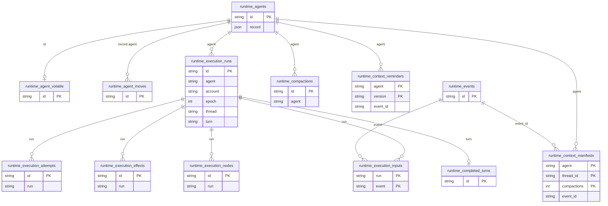

Inferred: all links. `runtime_agent_moves` holds the agent id inside its record. `runtime_budget` is historical and has no links.

### 2.2 Events and messages

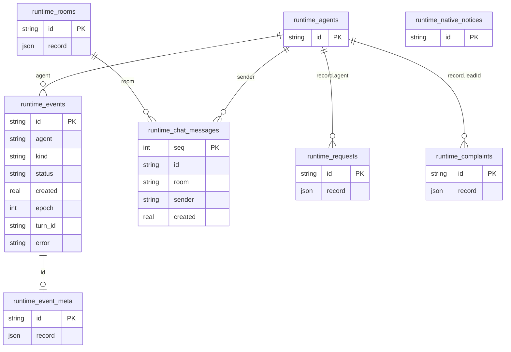

Inferred: all links. `runtime_events.status = 'queued'` marks the user message queue (there is no separate queue table). `runtime_event_meta` is joined by id in the sync and transcript code.

### 2.3 Transcript

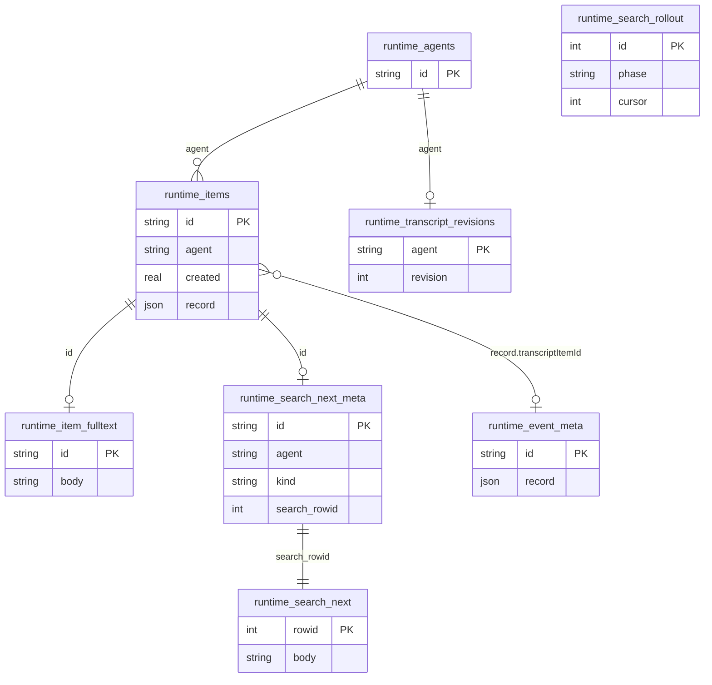

Inferred: all links. `runtime_search_next` is an FTS5 contentless table. Triggers on `runtime_agents` and `runtime_items` bump `runtime_transcript_revisions`.

### 2.4 Sync

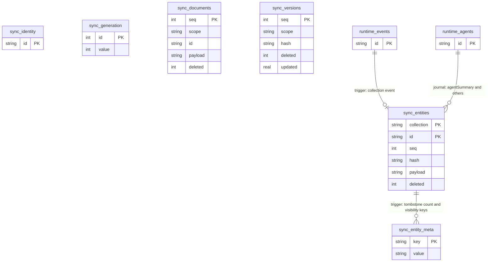

Inferred: all links. `seq` is one number space across `sync_entities`, `sync_documents` and `sync_versions` (the trigger takes the max of the three). Event triggers keep a window of 200 events. Other collections are written by the entity publication code (`entity_publication.rs`, `repositories/sync_documents.rs`).

### 2.5 Receipts and idempotency

See section 3 for the analysis. The diagram shows where each receipt table points.

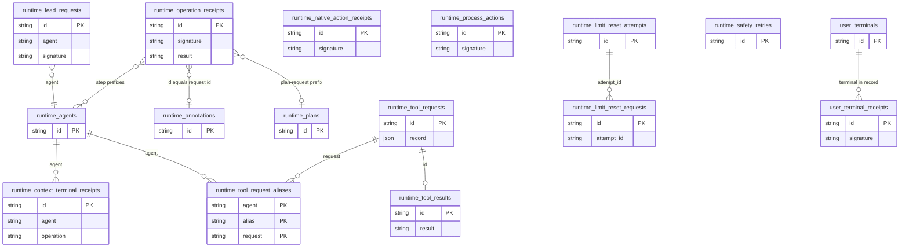

Inferred: all links. `runtime_operation_receipts.id` is a free string with a prefix that names the workflow, so the link depends on the prefix.

### 2.6 Queue and scheduling

The user message queue lives in `runtime_events` (status `queued`). These tables drive wake-up and retry.

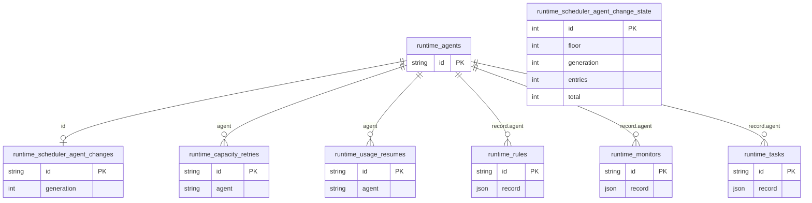

Inferred: all links.

### 2.7 Multi-server and federation

```mermaid
erDiagram
    runtime_server_links {
        string id PK
        json record
    }
    runtime_server_outbox {
        string id PK
        string server
        string state
        real next_at
    }
    runtime_server_inbox {
        string id PK
        string signature
        string state
    }
    runtime_server_fetch {
        string id PK
        string server
        string state
    }
    runtime_server_retired {
        string id PK
        string direction PK
        string server
    }
    runtime_server_exec {
        string id PK
        string owner
        string actor
    }
    runtime_server_exec_audit {
        string id PK
        string actor
        string server
    }
    runtime_server_exec_input {
        string id PK
        string handle
    }
    runtime_server_output_tools {
        string id PK
        real expires
    }
    runtime_federation_peers {
        string id PK
    }
    runtime_federation_rooms {
        string id PK
    }
    runtime_federation_outbox {
        string id PK
        string peer_id
    }
    runtime_federation_inbox {
        string peer_id PK
        string message_id PK
    }
    runtime_federation_nonces {
        string peer_id PK
        string nonce PK
    }
    runtime_federation_invites {
        string id PK
    }
    runtime_federation_identity {
        string id PK
    }
    runtime_federation_settings {
        string id PK
    }
    runtime_agents {
        string id PK
    }
    runtime_agents ||--o{ runtime_server_links : "record.parent / workers"
    runtime_server_links ||--o{ runtime_server_outbox : "payload link"
    runtime_server_exec ||--o| runtime_server_exec_audit : "id"
    runtime_server_exec ||--o| runtime_server_exec_input : "id"
    runtime_federation_peers ||--o{ runtime_federation_outbox : "peer_id"
    runtime_federation_peers ||--o{ runtime_federation_inbox : "peer_id"
    runtime_federation_peers ||--o{ runtime_federation_nonces : "peer_id"
```

Inferred: all links. `runtime_server_*` is the paired-server command channel. `runtime_federation_*` is the older peer messaging set. `runtime_peer_update_settings` is read by `multi_server.rs` but no non-test code creates it.

### 2.8 Workspaces and work

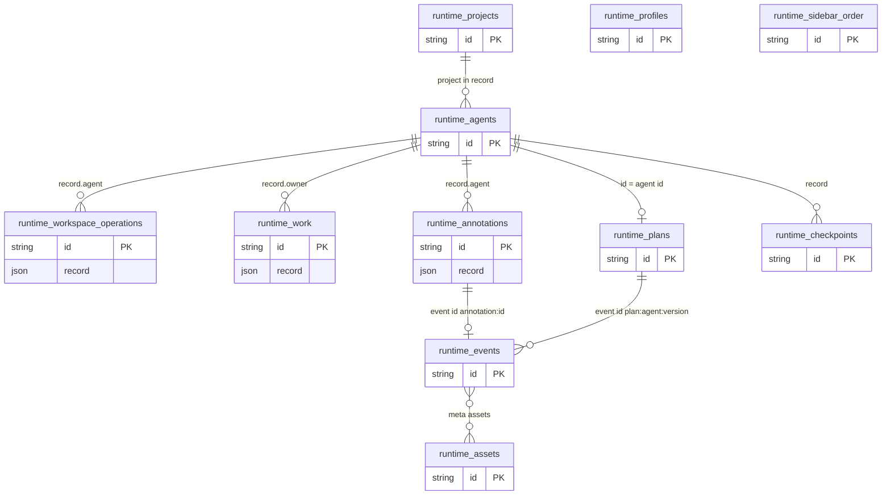

Inferred: all links.

### 2.9 Terminals and processes

User terminals live in Canvas. Process handles live in `supervisor.sqlite3`.

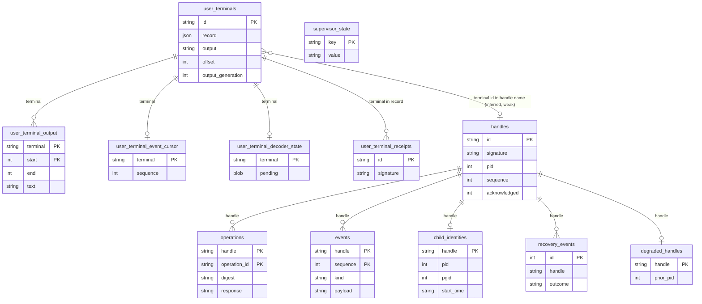

Inferred: all links, including the weak one between a terminal and a handle. `user_terminal_event_cursor.sequence` follows `events.sequence`. `runtime_server_exec_input.handle` also names a supervisor handle.

### 2.10 Accounts and access

`runtime_access_*` is remote client pairing and access. `runtime_account_transfers` moves agents between provider accounts.

```mermaid
erDiagram
    runtime_access_clients {
        string id PK
    }
    runtime_access_invites {
        string id PK
        string request_id
        string hash
    }
    runtime_access_nonces {
        string client PK
        string nonce PK
        int created
    }
    runtime_access_receipts {
        string client PK
        string request_id PK
        string hash
        string session
        string status
    }
    runtime_access_outbound {
        string server PK
        string request_id PK
        string hash
    }
    runtime_access_audit {
        int seq PK
        string client
        string actor
        string action
    }
    runtime_access_settings {
        int id PK
        int auto_pair
    }
    runtime_access_discovered {
        string id PK
    }
    runtime_access_auto_attempts {
        string id PK
    }
    runtime_access_unrevokes {
        string id PK
        string client
    }
    runtime_access_local_alias {
        int id PK
        string alias
    }
    runtime_access_name_targets {
        string id PK
        string server
        string label
    }
    runtime_access_name_requests {
        string id PK
        string label
        string actor
        int applied
    }
    runtime_access_alias_requests {
        string id PK
        string server
        string alias
    }
    runtime_account_transfers {
        string id PK
        json record
    }
    runtime_agents {
        string id PK
    }
    runtime_access_clients ||--o{ runtime_access_nonces : "client"
    runtime_access_clients ||--o{ runtime_access_receipts : "client"
    runtime_access_clients ||--o{ runtime_access_audit : "client"
    runtime_access_clients ||--o{ runtime_access_unrevokes : "client"
    runtime_access_name_targets ||--o{ runtime_access_name_requests : "id (inferred)"
    runtime_agents ||--o{ runtime_account_transfers : "record.agent"
```

Inferred: all links. Provider account data (keys, login state) is not in these databases. It is in `accounts/registry.json` in the state folder.

### 2.11 Analytics

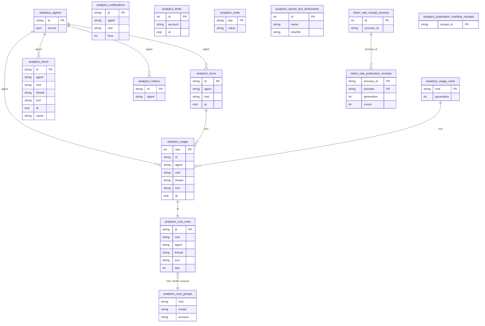

Inferred: all links. The canvas database holds no copy of these tables, except `runtime_analytics_projection` (a queue) and the shared helper tables `runtime_payload_migrations` and `runtime_stored_text_batches` (present in both databases).

### 2.12 Other

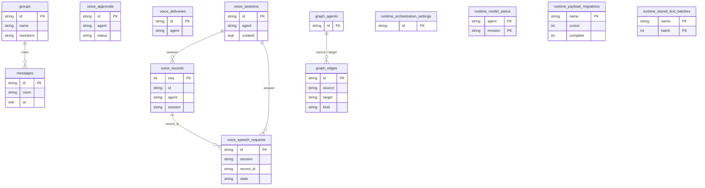

Inferred: all links. `groups`, `messages` and `graph_edges` are read by `sync_policy.rs` (chat group summaries). No writer was found in the services code read for this audit. `graph_agents` has no reader or writer found.

## 3. Receipts and ledgers

Scope: every table that stores a request id, receipt, nonce, outbox entry or inbox entry. `runtime_operation_receipts` is split by id prefix because one table serves many workflows.

Verdict meaning:

- yes: the receipt can become columns or fields of the main row.
- only with idempotent rewrite: the command must be rewritten so a replay recomputes the same result from the main row. Today the saved result is returned.
- no: the receipt has no suitable main row, or it is many-to-one, or it is a guard or queue by design.
- already one row: the table is the main row, or it already carries the id.

Rows marked "inferred" in the reason were judged from key names and prefixes, not from a full read of the writer.

| Receipt table or variant                                                                                                                                                                                               | Database   | Key                                           | Main row                                                  | Main row carries same request id?                                        | Can it live in the main row? | Reason                                                                                                           |
| ---------------------------------------------------------------------------------------------------------------------------------------------------------------------------------------------------------------------- | ---------- | --------------------------------------------- | --------------------------------------------------------- | ------------------------------------------------------------------------ | ---------------------------- | ---------------------------------------------------------------------------------------------------------------- |
| runtime_operation_receipts: `annotation` id                                                                                                                                                                            | canvas     | id = request id                               | runtime_annotations row (id = request id)                 | yes, same id                                                             | yes                          | Receipt result equals the annotation record. Only the signature is extra.                                        |
| runtime_operation_receipts: `plan-request:{id}`                                                                                                                                                                        | canvas     | plan-request:request id                       | runtime_plans row (one per agent, versioned)              | no                                                                       | no                           | Many request ids per plan row. The row is replaced on each save.                                                 |
| runtime_operation_receipts: `queue:{agent}:{id}`                                                                                                                                                                       | canvas     | queue:agent:request id                        | queued events of the agent                                | no                                                                       | only with idempotent rewrite | Reorder and send-now touch many events. Replay must return the saved result.                                     |
| runtime_operation_receipts: `work-*`, `project-registration:`                                                                                                                                                          | canvas     | prefix + request id                           | runtime_work or runtime_projects row                      | no (work has version, not request id)                                    | only with idempotent rewrite | Writes use signature compare plus version check. Replay needs the saved result. Inferred from prefix.            |
| runtime_operation_receipts: `account-worker:*`, `lifecycle-*`, `stopped-turn-*`, `provider-turn:`, `provider-submission:`, `claude-steer:`, `idle-compaction:`, `liveness`, `linux-vm-provider-start:`, `limit-reset:` | canvas     | prefix + agent/turn/step                      | agent or run, one marker per step                         | no                                                                       | no                           | Step markers. Many per agent and per turn. Lifetime differs from the agent row.                                  |
| runtime_operation_receipts: `studio-errors:incident:{event id}`, `studio-errors:dismissed:`                                                                                                                            | canvas     | prefix + event id                             | runtime_events row (id in key)                            | id is in the key, not stored on the row                                  | yes                          | Key is derived from the event id. A flag on the event meta record would do. Inferred from studio_errors.rs join. |
| runtime_lead_requests                                                                                                                                                                                                  | canvas     | id = request id; agent, signature             | runtime_agents row                                        | yes: agent id = request id and record has quickCreateRequest (signature) | only with idempotent rewrite | Primary path is already in the agent. The alias row is needed when a reused agent has another id.                |
| runtime_tool_requests                                                                                                                                                                                                  | canvas     | id = tool request id                          | is the main row                                           | n/a                                                                      | already one row              | The request is the main row.                                                                                     |
| runtime_tool_request_aliases                                                                                                                                                                                           | canvas     | (agent, alias, request)                       | runtime_tool_requests row                                 | no                                                                       | yes                          | Aliases fit as an array in the request record. Lookup by alias needs an index.                                   |
| runtime_tool_results                                                                                                                                                                                                   | canvas     | id = tool request id                          | runtime_tool_requests row (same id)                       | yes, same id                                                             | yes                          | One result per request. Could be a field of the request record.                                                  |
| runtime_native_action_receipts                                                                                                                                                                                         | canvas     | id; signature, receipt, outcome               | none (native provider action)                             | no                                                                       | no                           | No main row to hold it.                                                                                          |
| runtime_context_terminal_receipts                                                                                                                                                                                      | canvas     | id; agent, operation                          | agent (context repair phase)                              | no                                                                       | no                           | Several operations per agent. Inferred from columns.                                                             |
| runtime_process_actions                                                                                                                                                                                                | canvas     | id = request id                               | is the main row (record has requestId, signature, result) | yes                                                                      | already one row              | Receipt and action are already one row.                                                                          |
| runtime_limit_reset_requests                                                                                                                                                                                           | canvas     | id = request id; attempt_id                   | runtime_limit_reset_attempts row                          | no                                                                       | no                           | Many request ids bind to one attempt. Lookup is by request id.                                                   |
| runtime_limit_reset_attempts                                                                                                                                                                                           | canvas     | id = attempt id                               | is the main row                                           | n/a                                                                      | already one row              | Attempt ledger. The charge guard.                                                                                |
| runtime_safety_retries                                                                                                                                                                                                 | canvas     | id                                            | none (journal before hand-off)                            | n/a                                                                      | no                           | Retry journal. No main row.                                                                                      |
| user_terminal_receipts                                                                                                                                                                                                 | canvas     | id; signature, result                         | user_terminals row (terminal id differs from receipt id)  | no                                                                       | only with idempotent rewrite | Terminal create could hold it. Input and close commands repeat per terminal.                                     |
| runtime_execution_inputs                                                                                                                                                                                               | canvas     | (run, event)                                  | runtime_events row (event)                                | no                                                                       | only with idempotent rewrite | An event may join more than one run after a retry. Index on event exists.                                        |
| runtime_context_reminders                                                                                                                                                                                              | canvas     | (agent, version); event_id                    | agent                                                     | no                                                                       | no                           | Many versions per agent.                                                                                         |
| runtime_completed_turns                                                                                                                                                                                                | canvas     | id = turn id                                  | runtime_execution_runs row (has turn column)              | no                                                                       | yes                          | A completed flag in the run record would do. Inferred.                                                           |
| voice_speech_requests                                                                                                                                                                                                  | canvas     | id; session, record_id, state                 | voice_records row (record_id)                             | no                                                                       | only with idempotent rewrite | Request state machine. Needs idempotent rewrite of the speech command. Inferred.                                 |
| runtime_access_receipts                                                                                                                                                                                                | canvas     | (client, request_id); hash, session, status   | none (client request)                                     | no                                                                       | no                           | No main row. Pruned by completed time.                                                                           |
| runtime_access_outbound                                                                                                                                                                                                | canvas     | (server, request_id); hash                    | none (outbound request)                                   | no                                                                       | no                           | No main row. Pruned by completed time.                                                                           |
| runtime_access_invites                                                                                                                                                                                                 | canvas     | id; request_id UNIQUE                         | is the main row                                           | yes, column                                                              | already one row              | request_id is already a column of the invite.                                                                    |
| runtime_access_nonces                                                                                                                                                                                                  | canvas     | (client, nonce); created                      | none                                                      | n/a                                                                      | no                           | Replay guard with age pruning.                                                                                   |
| runtime_access_name_requests                                                                                                                                                                                           | canvas     | id; applied                                   | runtime_access_name_targets (id)                          | inferred, same id                                                        | only with idempotent rewrite | Apply flag could be a column of the target. Needs idempotent apply. Inferred.                                    |
| runtime_access_alias_requests                                                                                                                                                                                          | canvas     | id; server, alias                             | runtime_access_local_alias / server alias                 | no                                                                       | no                           | Single alias row cannot hold many request ids.                                                                   |
| runtime_federation_outbox                                                                                                                                                                                              | canvas     | id; peer_id                                   | is the main row (message to deliver)                      | n/a                                                                      | already one row              | Delivery queue with retry. Own rows by design.                                                                   |
| runtime_federation_inbox                                                                                                                                                                                               | canvas     | (peer_id, message_id)                         | runtime_chat_messages or event row                        | no                                                                       | only with idempotent rewrite | Dedupe of received messages. Delivery also writes an operation receipt. Inferred.                                |
| runtime_federation_nonces                                                                                                                                                                                              | canvas     | (peer_id, nonce); created                     | none                                                      | n/a                                                                      | no                           | Replay guard with age pruning.                                                                                   |
| runtime_server_outbox                                                                                                                                                                                                  | canvas     | id = identity(kind, source id); server, state | source event (id inside the key)                          | no                                                                       | no                           | Queue with attempts and next_at. Not a receipt.                                                                  |
| runtime_server_inbox                                                                                                                                                                                                   | canvas     | id; signature, state, result                  | varies (effect of the command)                            | no                                                                       | only with idempotent rewrite | Inbound command receipt with state. Needs idempotent commands.                                                   |
| runtime_server_fetch                                                                                                                                                                                                   | canvas     | id; server, signature, state                  | none                                                      | no                                                                       | no                           | Ledger of a cross server fetch.                                                                                  |
| runtime_server_retired                                                                                                                                                                                                 | canvas     | (id, direction)                               | none                                                      | no                                                                       | no                           | Tombstones for retired ids.                                                                                      |
| runtime_server_exec_input                                                                                                                                                                                              | canvas     | id = request id; handle                       | runtime_server_exec row (same id)                         | yes, same id                                                             | yes                          | Handle is one field of the exec record.                                                                          |
| token_rate_publication_receipts                                                                                                                                                                                        | analytics  | (process_id, provider)                        | none                                                      | no                                                                       | no                           | Per process cursor. No main row.                                                                                 |
| analytics_publication_overflow_receipts                                                                                                                                                                                | analytics  | receipt_id                                    | none                                                      | no                                                                       | no                           | Counter per receipt.                                                                                             |
| operations                                                                                                                                                                                                             | supervisor | (handle, operation_id); digest, response      | handles row                                               | no                                                                       | no                           | Many operations per handle. Replay response must stay.                                                           |
| events                                                                                                                                                                                                                 | supervisor | (handle, sequence)                            | handles row (acknowledged)                                | no                                                                       | no                           | Ordered event log with ack cursor.                                                                               |

Tally by row of the table above: yes 6, only with idempotent rewrite 9, no 19, already one row 5.

Namespaces seen as constants or formats for `runtime_operation_receipts.id`: `queue:`, `plan-request:`, `plan:`, `work-result:`, `work-ready:`, `work-decision:`, `work-archive:`, `project-registration:`, `account-worker:`, `account-transfer:`, `lifecycle-interrupt:`, `lifecycle-terminals:`, `stopped-turn-interrupt:`, `stopped-turn-terminals:`, `provider-turn:`, `provider-submission:`, `provider-notification:`, `claude-steer:`, `idle-compaction:`, `limit-reset:`, `linux-vm-provider-start:`, `linux-vm-credential-copy:`, `manual-release:`, `liveness:`, `studio-errors:incident:`, `studio-errors:dismissed:`, `diagnostics:`, `catalog-discovery`, `native-review:`, `agent-delete-voice:`, `voice:`. The write path of a user message was not traced for this audit, so its request id handling is not classified.

## 4. Counts

Counted from the schema source: snapshot plus the code that creates objects. Indexes exclude the automatic indexes of `PRIMARY KEY` and `UNIQUE`. Virtual table shadow tables are not counted.

| Database           | Tables | Triggers | Indexes |
| ------------------ | ------ | -------- | ------- |
| canvas.sqlite3     | 111    | 45       | 108     |
| analytics.sqlite3  | 17     | 3        | 18      |
| supervisor.sqlite3 | 7      | 0        | 1       |
| Total              | 135    | 48       | 127     |

How the numbers were built:

- Canvas tables: 77 in the snapshot, 29 more in `feature_schema.rs`, 3 more from other files (`runtime_transcript_revisions`, `runtime_agent_volatile`, `runtime_stored_text_batches`), 2 more from `sync_schema.sql` (`sync_identity`, `sync_generation`). `runtime_search_next` is an FTS5 table and counts as one. `runtime_peer_update_settings` is not counted because no non-test code creates it.
- Canvas triggers: 10 in the snapshot, 10 new in `sync_schema.sql` (4 scope, 6 transcript revision), 8 `summary_*` triggers in `feature_schema.rs`, 12 work triggers in `entity_publication.rs` (6 history, 6 identity), 5 in `agent_volatile.rs`.
- Canvas indexes: 80 in the snapshot, 8 new in `feature_schema.rs`, 20 more named in repository code (agent, monitor, request, reviewer archive, scheduler). This is an upper bound. Some snapshot names are old versions that the code now replaces (for example `runtime_agent_account_wake_candidates_v5` replaces v4, `runtime_agent_root_v2` replaces `runtime_agent_root`).
- Analytics tables: 9 in the snapshot, 8 more from `cost_aggregate.rs` (2), `stored_text_dictionary.rs` (1), `stored_text_compaction.rs` (1), `feature_schema.rs` payload migrations (1), `analytics_capture.rs` (3).
- Analytics indexes: 12 in the snapshot, 4 in `cost_aggregate.rs`, 1 covering index in `m2026_10_27_cost_index.rs`, 1 in `stored_text_dictionary.rs`. Analytics triggers: 3 immutability triggers on the dictionary table.
- Supervisor: 7 tables in `supervisor_schema.sql`, 1 partial index `operations_monitor_native` in `supervisor_journal.rs`.

Objects dropped by migrations (not counted): `runtime_turn_item_links_v1`, `runtime_budget_usage`, `runtime_model_modes`, `runtime_native_*` sweep tables, `runtime_payload_refs`, `runtime_search*` old tables, `analytics_cost_*_v1` tables, and their triggers (`m2026_10_27_retired_sqlite.rs`).
