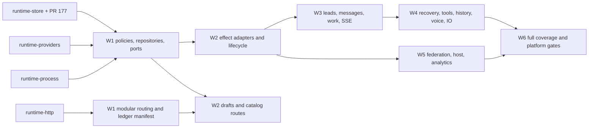

# Rust runtime work breakdown

For the lead assigning M-08.2 of [issue #37](https://github.com/ifdotpy/codex-studio/issues/37).
**Assign the foundation leaves in wave 1 now; unblock drafts/catalog next, then
lead creation and message delivery. Do not use seven passing HTTP suites as the
cutover gate.** Keep Python in production until the complete backend, supervisor,
CLI, state and platform gates pass.

Evidence baseline: `ffc74c19b59f1900627b29bcdfd69e915a1376c5` (main), plus
`origin/feat/rust-runtime-store` at `ed31a18af2926fecd723dcd454dad64fa1a6307e`
([PR #177](https://github.com/ifdotpy/codex-studio/pull/177), branch-only).
Read together with [stack decision](rust-runtime-stack.md),
[acceptance criteria](rust-workspaces.md#acceptance-criteria),
[state formats](../runtime-state-formats.md), and
[caller inventory](../backend-caller-inventory.md). No backend was started for
this analysis; no live accounts, state, model requests or load tests were used.

The committed [OpenAPI authority](../../workspaces/runtime/packages/runtime-http/openapi.json)
has 159 operations. The [recorded ledger](../verification/rust-runtime-http-conformance-summary.md)
has 3 implemented, 156 returning 501, and 3 passing / 18 failing tests in seven
suites. These are inherited measurements, not a new run. First blockers are
`POST /api/leads` (12 failures), `GET /api/sync/protocol` (2), then accounts,
stream, chats and drafts. A blocked setup hides subsequent assertions: fixing
one route does not imply twelve tests will pass.

## Ownership and integration

The lead's 2026-10-12 decision replaces the first-slice whole-crate rule:

Correction (2026-10-12, after the first assignment): application services do
not live in the server binary. Route modules are in `studio-runtime-http`, and
no crate may depend on the application, so a handler could not call a service
placed there. Services are leaf modules of the library crate
`studio-runtime-services` (`workspaces/runtime/packages/runtime-services`):
`operations ← store, providers, process ← services ← http ← runtime-server`.
Every `A/<name>.rs` below is `runtime-services/src/<name>.rs`.

- Each slice owns named leaf modules and its own tests only. The tables below
  name those leaves; no worker edits another slice's files.
- The lead alone owns root `Cargo.toml`, `Cargo.lock`, crate `lib.rs`/`mod.rs`
  registration, the router merge table, binary wiring, the ledger's implemented
  list and `openapi.json`. Workers submit proposed integration lines. Schema
  changes remain outside this port; the frozen hash is not a knob to turn.
- Wave 1 removes the hand-maintained ledger allowlist: derive an implementation
  manifest from the Rust route registrations and expose it through a binary
  inspection command or test artifact, not a new public HTTP operation. Each
  module exports its routes and descriptors together; the router merges them.
  One group then needs at most one shared registration line.
- Also derive table-family inventories from the existing schema fixture,
  consume the existing provider replay files directly, and keep generated DTOs
  in `OUT_DIR`. Do not create parallel route, fixture, schema or DTO registries.
  Keep the app wiring explicit; replacing a few merge lines with plugin discovery
  is unnecessary complexity.
- Same-wave workers cannot consume one another's new types/functions. Foundation
  contracts land first. A vertical slice may implement its own route, service
  and repository leaves together. The lead wires them after review, then runs
  the actual Rust HTTP caller before accepting the slice.

Choose router groups for the census, but smaller service/route slices for work:
`agents` and `work` cross too many lifecycle boundaries to assign to one worker.
The undocumented voice fallback belongs to `voice`; five documented federation
GETs deliberately return 404 and still count as implemented contracts.

## Measurement and coverage rules

All abbreviated Python paths below are relative to
`workspaces/runtime/apps/server/src/` (**S**); **T** means
`workspaces/runtime/apps/server/tests/`. Appendix references give function name,
file and definition line. The checker counts AST `end_lineno - lineno + 1`,
including blank/comment lines, excluding decorators. A shared function is counted
once per group, and may occur in several groups. **Hdl/Callee is a bounded
one-hop measure, not a transitive implementation estimate.** Callees include
resolved Runtime mixins, service ports and local wrapper targets; general
request/response helpers are excluded. Background callbacks and downstream
helpers are owned in the service table. Module sizes are physical lines from a
script, including declarations; they must not be added to the handler totals.

Coverage is a source census, not measured branch coverage or a claim that tests
passed here. **H** means a request exercised by one of the seven replaceable
HTTP-harness suites, including negative requests. **I** means only a Python-bound
route/service contract was found (TestClient, direct Runtime calls, or a fixture
that constructs Python and also uses a local socket). **N** means neither was
found in that census. An I mapping from a service test to its route is an
**inference** about behavior coverage; it does not prove HTTP wiring. A schema
registration assertion or a fake's method declaration alone does not count.
The appendix gives one auditable witness per operation; related suites below
are additional evidence. Dynamically constructed paths were checked manually,
including voice actions and the SSE request.

### Route groups and state/effects

Operations and exact implementing functions are enumerated once in the appendix.
Table-family names below omit `runtime_` unless explicitly qualified. Reads are
R, writes are W; W includes reads needed for guarded updates. Every durable
mutation also involves sync publication and may use operation receipts. P =
provider session; S = supervisor; F = filesystem; T = terminal; N = network;
B = background workers. Effects are the union of a group's paths, not a claim
that every request performs every effect.

| Group        |           Ops | Hdl / Callee lines | State read / written                                                                                                                                                                                        | Effects   | Main difficulty                                                                                  |
| ------------ | ------------: | -----------------: | ----------------------------------------------------------------------------------------------------------------------------------------------------------------------------------------------------------- | --------- | ------------------------------------------------------------------------------------------------ |
| core         |             1 |              2 / 0 | Process session token; no tables                                                                                                                                                                            | none      | Trust and token disclosure boundary                                                              |
| accounts     |            24 |         211 / 1061 | R agents, budget/usage/resumes; W projects, sidebar_order, operation_receipts, limit_reset_requests/attempts; account `registry.json` is a file, not a table                                                | P S F N B | Login/reset identities, unknown charge outcome, cache refresh and remote project receipts        |
| agents       |            30 |         230 / 2084 | R/W agents, lead_requests, agent_moves, account_transfers, tasks, execution_*, events, capacity_retries, usage_resumes, workspace_operations, operation_receipts; project/settings files                    | P S F N B | Epoch/capacity reservations, exact create replay, stop/recovery, workspace acquisition           |
| work         |            33 |         143 / 1612 | R/W work, plans, annotations, requests, complaints, rooms, chat_messages, profiles, rules, tool_requests/results/aliases, events; Canvas `groups/messages/graph_agents/graph_edges`; R tasks/items/monitors | P S F N B | Durable message/tool IDs, permissions, queue ordering, cancellation and publication after commit |
| history      |            11 |          128 / 907 | R items/item_fulltext/search*, tasks, agents; W checkpoints, workspace_operations, payload_refs, operation_receipts; branch writes agents/events                                                            | P S F B   | Cursor stability, full-text indexing, idle/epoch checks, restore uncertainty                     |
| insights     |             3 |           44 / 483 | R analytics_* and runtime agents/tasks/items/budget; W derived cost caches and analytics projections via maintenance                                                                                        | F B       | Snapshot consistency, source signatures, lazy refresh, streaming export                          |
| io           |            13 |           52 / 554 | R agents/assets/monitors; W assets, monitors, operation_receipts; terminal metadata/history and monitor logs                                                                                                | P S F T B | PTY ownership, input offsets, ranged reads, containment, lost command replies                    |
| sync         |             6 |          204 / 562 | R/W sync_documents/entities/entity_meta/versions; R projected runtime families; preference fields in sync documents                                                                                         | F B       | Workspace identity, merge conflicts, entity hashes, monotone cursors, SSE cancellation           |
| sync-relay   |             1 |           27 / 140 | R entity sequence; in-memory notify receipts/subscribers, no durable receipt table                                                                                                                          | N B       | Authenticated invalidation, duplicate identity, publication failure                              |
| system       |             6 |          189 / 533 | R accounts/agents/monitors and diagnostics; remote directory requests W server_outbox/operation_receipts; VM/recovery settings files                                                                        | P S F N B | Build/state identity, remote path authorization, packaging and readiness                         |
| federation   |            10 |           30 / 141 | R/W federation_identity/peers/invites/nonces/settings/rooms/inbox/outbox; chat_messages/agents/rooms                                                                                                        | F N B     | Exact signed bytes, nonce replay, outbox/inbox reconciliation                                    |
| multi_server |            10 |           81 / 362 | R/W access_*; server_links/sequence/inbox/outbox/fetch/output_tools/retired, operation_receipts; transported actions reach agents/work/projects                                                             | F N B     | Principal binding, durable request IDs, signed envelopes, uncertain remote effects               |
| voice        | 11 + fallback |          115 / 254 | R/W voice_sessions/records/approvals/deliveries; R agents/requests; W events through message delivery; private audio files                                                                                  | P S F N B | Session/event/chunk/message IDs, changed retries, native realtime callbacks, approval identity   |

State evidence: `codex_runtime.py:2013` (transaction context), `:3334` (`_put`),
`codex_canvas.py:89` (Canvas schema), `codex_accounts.py:84` (file registry),
`codex_voice.py:13` (lazy voice schema), `codex_limit_resets.py:72`, and the
modules/function targets in the appendix. R/W unions include delegated effects;
they are not a permission matrix or exhaustive dynamic SQL trace.

## Shared services and fast seams

These services have no independent HTTP route. Route slices reuse them; do not
copy their behavior into handlers. “Pure” means the decision/projection can run
without a database or provider, not that its complete service has no effects.
Use explicit input snapshots, clocks and event sequences for the seconds-long
hypothesis loop, then test the adapter against disposable state/protocol replay.

| Service / owned state                                                                                                | Measured Python source (physical lines)                                                                                                                                                                                                           | Consumers                                                            | Pure seam and remaining adapter                                                                                                              |
| -------------------------------------------------------------------------------------------------------------------- | ------------------------------------------------------------------------------------------------------------------------------------------------------------------------------------------------------------------------------------------------- | -------------------------------------------------------------------- | -------------------------------------------------------------------------------------------------------------------------------------------- |
| Scheduler and turn lifecycle: execution attempts, epochs, active slots, pending preparation                          | `codex_runtime.py:1` 11514 overall; scheduler `:6322–6866` 545 lines, start/settlement `:6867–7462` 596; `codex_execution.py:1` 409; `codex_turn_recovery.py:1` 633; `codex_restart_recovery.py:1` 194; `codex_task_recovery.py:1` 462            | agents, work, history, voice                                         | Pure admission, permission selection and transition decisions; serialized transaction and provider dispatch adapters remain                  |
| Event queue/delivery: durable event state, message receipts, per-agent ordering, notification queues                 | Runtime `:4261–4461` 201 and `:5274–5388` 115; `codex_workspace_delivery.py:1` 50; `codex_streaming.py:1` 249; `native_notifications/dispatch.py:1` 292; Runtime `:7690–8302` 613 notification body/routing region                                | agents, work, sync, voice, io                                        | Pure duplicate/reorder/epoch decisions; commit-before-publish and bounded callback dispatch need adapters                                    |
| Sync projection/SSE: projected entity hashes, generations, subscriber baselines/cursors                              | `codex_sync.py:1` 620; `codex_sync_entities.py:1` 1113; `studio_api/sync/resources/hub.py:1` 948; `studio_api/sync/preferences.py:1` 154; `studio_api/sync/resources/relay/receipts.py:1` 74                                                      | all mutators; sync, sync-relay                                       | Pure projection, preference merge and subscription reduction; DB triggers, cancellation and filesystem watch lifecycle are effectful         |
| Accounts/catalog: registry identity, model catalog, authentication and transfer state                                | `codex_accounts.py:1` 833; `codex_catalog.py:1` 212; `codex_worker_accounts.py:1` 164; `codex_model_catalog_reader.py:1` 276; `codex_claude_login.py:1` 492; `codex_account_transfer.py:1` 2113                                                   | accounts, agents, system, insights                                   | Pure catalog selection/metadata projection; filesystem auth, process login, transfer and native discovery are not pure                       |
| Worker creation/workspaces: reservations, directories, image/worktree/VM ownership                                   | Runtime `:4532–4906` 375, `:5550–5825` 276, `:5847–6321` 475, `:8468–8719` 252; `codex_worker_workspace.py:1` 61; `codex_worktree_creation.py:1` 266; `codex_worker_environment.py:1` 58; `codex_vm_agents.py:1` 390; `codex_workspace.py:1` 2255 | agents, work, history, io, accounts                                  | Pure validation/reservation decisions; Git/image/VM creation, checkpoint and migration require adapters                                      |
| Monitors/watches/terminals: handles, offsets, command receipts, retained results, schedules                          | Runtime `:9802–10670` 869; `codex_rules.py:1` 817; `codex_monitor_recovery.py:1` 183; `codex_progress_watch.py:1` 288; `codex_terminals.py:1` 730                                                                                                 | io, work, agents, sync                                               | Pure rule readiness, cursor/recovery classification; supervisor, PTY and OS watch implementations are effectful                              |
| Usage/capacity: usage receipts, budgets, refresh gates, reset-credit attempts                                        | `codex_budget.py:1` 402; `codex_capacity_retry.py:1` 334; `codex_usage_resume.py:1` 489; `codex_limit_resets.py:1` 186; `codex_token_rate.py:1` 465                                                                                               | accounts, agents, work, insights, sync                               | Pure arithmetic, cap/resume and charge reconciliation decisions; clock/network/DB adapters preserve unknown outcomes                         |
| Analytics/costs: history/projections, cache signatures and import cursor                                             | `codex_analytics.py:1` 1328; `codex_analytics_history.py:1` 830; `codex_session_costs.py:1` 856; `codex_cost_usage.py:1` 462                                                                                                                      | insights, accounts, system                                           | Pure parsing and aggregation; SQLite history and provider rollout readers are adapters                                                       |
| Payload storage/migration: content hashes, references, GC ownership, task cursor                                     | `codex_payloads.py:1` 337; `codex_payload_migrate.py:1` 276                                                                                                                                                                                       | history, work, agents, io                                            | Pure reference/hash/eligibility logic; fsync/rename/GC lock and migration compare-and-swap need real disposable files                        |
| Federation/multi-server: cryptographic identity, nonce windows, paired principals, durable inbound/outbound receipts | `codex_federation.py:1` 1291; `codex_multi_server.py:1` 994; `codex_multi_server_orchestration.py:1` 1570; `codex_server_transport.py:1` 19; `codex_server_discovery.py:1` 302; `codex_multi_server_crypto.py:1` 122                              | federation, multi_server, sync-relay, accounts, agents, work, system | Pure envelope/signature inputs and receipt reconciliation; transport and storage are adapters, no automatic retry of unknown effect          |
| Voice: realtime session, record ordering, audio chunks, delivery/approval identity                                   | `codex_voice.py:1` 263; `codex_native_voice.py:1` 458                                                                                                                                                                                             | voice, work, agents, sync                                            | Pure validation/deduplication and speech/approval state; provider realtime, audio files and callback delivery are effectful                  |
| Provider session/recovery: RPC pending book, child generation, preparation, repair proof                             | Runtime `:437–1447` 1011; `codex_claude.py:1` 293; `codex_connection_recovery.py:1` 1093; `codex_context_repair.py:1` 2132; `codex_native_tools.py:1` 686; `codex_process_supervisor.py:1` 1869                                                   | agents, accounts, work, io, voice, history                           | Pure repair/proof/unknown-result decisions; wire codec alone is insufficient: process attach, callback draining and durable ACK are required |
| Work coordination/UI: work lifecycle, tool receipts, questions, panels                                               | `codex_work.py:1` 1843; `codex_tool_requests.py:1` 650; `codex_questions.py:1` 134; `codex_panel.py:1` 30; `codex_progress_layout.py:1` 331; `codex_canvas.py:1` 769                                                                              | work, agents, history, sync                                          | Pure work transitions/authorization/layout; persistence and worker wakeups are adapters                                                      |
| Host integration: VM settings, vault, Mac sync, project secrets                                                      | `codex_linux_vm.py:1` 1039; `codex_linux_workspaces.py:1` 164; `codex_vm_vault.py:1` 471; `codex_vm_mac_sync.py:1` 918; `codex_project_secrets.py:1` 114                                                                                          | agents, system, accounts, io                                         | Pure path/receipt/configuration checks; subprocess/guest/network/OS credential interactions require platform adapters                        |

The 11514-line Runtime total includes the listed regions; regions are inclusive
physical spans, not additional modules. Imported helpers beyond this table are
part of the caller's slice and must be enumerated before implementation, not
silently omitted. In particular, account transfer, context repair and workspace
must be split at the existing method boundaries below rather than assigned as
one “agent runtime” rewrite.

## Dependency graph and waves

Diagram contract: arrows mean “must be available before the consumer”; the four
existing crates are foundations, not evidence that their complete adapters exist.
The invariant is an acyclic synchronous core behind the async HTTP edge. Source:
this plan and the four crate READMEs.



### First-wave assignments and service dependencies

`A` below is `workspaces/runtime/packages/runtime-services/src/` (the
application services crate; see the correction under Ownership and integration); `H`, `D`, `P`, `X`
are respectively `runtime-http`, `runtime-store`, `runtime-providers`,
`runtime-process` under `workspaces/runtime/packages/`, each followed by `src/`.
Every named leaf owns a matching colocated test module. No new third-party
crate is implied. Domain decisions can be pure functions inside an app service
leaf; a new domain crate requires an actual independent caller, not a folder
for every worker.

| Slice, wave            | Exclusive leaves                                                      | Python behavior budget / dependency                                                                                        | Exit criterion                                                                                                                                            |
| ---------------------- | --------------------------------------------------------------------- | -------------------------------------------------------------------------------------------------------------------------- | --------------------------------------------------------------------------------------------------------------------------------------------------------- |
| edge-manifest, 1       | `H/routes/manifest.rs`, `H/routes/compose.rs`; ledger inspection test | Existing route table and ledger allowlist only; depends on merged HTTP crate                                               | Same 3/156 ledger baseline, seven suites still discovered; no hand-edited implemented registry; per-module route composition tested                       |
| store-bootstrap, 1     | `D/bootstrap.rs`, `D/feature_schema.rs`                               | Runtime initialization `:1518–1973` (456) + db `:2013–2245` (233), schema snapshot and lazy-feature setup; depends on #177 | Existing-state and fresh-state fixtures readable in Python after Rust writes; unchanged schema; ledger stays 3/156                                        |
| sync-policy, 1         | `A/sync_policy.rs`, `D/sync_documents.rs`                             | SyncStore 620 + entity projection 1113 = 1733; depends on #177 and generated DTOs                                          | Pure projections + draft merge fixtures; exact entity payload/hash cases; expose snapshot/cursor and write-result port for later routes; 0 new operations |
| event-policy, 1        | `A/event_policy.rs`, `D/delivery.rs`                                  | Runtime enqueue/send regions 316 + delivery 50 + streaming 249 = 615                                                       | Same-ID/content/conflict and epoch/order transition tests; one commit contains receipt + event; emits post-commit invalidations; 0 new operations         |
| admission-policy, 1    | `A/admission.rs`, `D/execution.rs`                                    | Scheduler region 545 + execution 409 + budget 402 = 1356                                                                   | Pure admission/permission selection and typed execution snapshot/intents; no clock sleeps/provider; 0 new operations                                      |
| account-policy, 1      | `A/account_policy.rs`, `D/account_state.rs`                           | Accounts/catalog/worker/model-reader 1485                                                                                  | Registry/catalog parsing and selection with supplied bytes; limits snapshot projection; typed filesystem/provider ports declared here; 0 new operations   |
| provider-session, 1    | `P/session.rs`, `P/dispatch.rs`                                       | AppServer 1011 + Claude transport 293 = 1304                                                                               | Existing provider replay frames, missing/late/orphan replies; callback ordering and pending-state decisions without live provider; 0 new operations       |
| supervisor-host, 1     | `X/supervisor_host.rs`, `X/journal.rs`                                | Python supervisor 1869                                                                                                     | All 12 v1 actions and stream/ACK/reattach checks against Rust supervisor, not only Python-hosted client tests; 0 new operations                           |
| payload-store, 1       | `D/payloads.rs`, `D/payload_migration.rs`                             | Payload modules 613                                                                                                        | Hash/size/atomic write, interrupted migration and GC exclusion fixtures; 0 new operations                                                                 |
| work-policy, 1         | `A/work_policy.rs`, `D/work_items.rs`                                 | Work module 1843                                                                                                           | Work/dependency/claim transitions and scoped snapshot port; no scheduler callbacks; 0 new operations                                                      |
| resource-policy, 1     | `A/resources.rs`                                                      | Hub 948 + preferences 154 + relay receipts 74 = 1176                                                                       | Pure subscribe-before-baseline/cursor reducer and injectable watcher port; cancellation/duplicate notification tests; 0 new operations                    |
| usage-policy, 1        | `A/usage_policy.rs`, `D/usage.rs`                                     | Capacity 334 + resume 489 + reset 186 + rate 465 = 1474                                                                    | Pure quota/resume/reset-receipt state transitions; no charge request; 0 new operations                                                                    |
| coordination-policy, 1 | `A/coordination.rs`, `D/chat.rs`                                      | Canvas 769 + questions 134 + layout 331 + panel 30 = 1264                                                                  | Typed chat/question/layout snapshots and mutation results; exact message identity; 0 new operations                                                       |
| remote-policy, 1       | `A/remote_policy.rs`, `D/access.rs`                                   | Access 994 + discovery 302 + crypto 122 = 1418                                                                             | Signed envelope/principal/nonce and receipt transitions on supplied inputs; network port declared; 0 new operations                                       |

These assignments are available on merged code + #177 today. Foundation leaves
must accept explicit inputs and return decisions/receipts; they must not import
one another's unmerged leaves. Existing `operations` reservation/settlement
logic is reused. The PyO3 command set stays frozen.

| Wave 2 service slice | Exclusive leaves                             | Depends on wave 1                   | Bounded Python scope and acceptance before route consumers                                                                                                                                                                              |
| -------------------- | -------------------------------------------- | ----------------------------------- | --------------------------------------------------------------------------------------------------------------------------------------------------------------------------------------------------------------------------------------- |
| turn-driver          | `A/turn_driver.rs`                           | admission, event, provider, store   | Start/settlement 596 + turn recovery 633 + restart 194 = 1423; fake-provider start/unknown/late-result and restart cases                                                                                                                |
| event-driver         | `A/event_driver.rs`                          | event, provider, resource           | Notification region 613 + native dispatch 292 = 905; persist before supervisor ACK, no duplicate delivery                                                                                                                               |
| worker-driver        | `A/worker_driver.rs`, `X/workspaces.rs`      | admission, provider, account, store | Create 375 + preparation 475 + spawn 252 + worktree 266 + environment 58 = 1426; gated first-turn ordering and exact workspace reservation                                                                                              |
| account-driver       | `A/account_driver.rs`                        | account, provider, usage            | Login manager 492 plus account filesystem effects already modeled by account-policy; cached reads and fake login/reset transport                                                                                                        |
| monitor-driver       | `A/monitor_driver.rs`, `D/monitors.rs`       | event, supervisor, admission        | Runtime monitor region 869 + recovery 183 + rules 817 = 1869; operation-status recovery and durable finish-before-wakeup                                                                                                                |
| terminal-driver      | `X/terminals.rs`, `X/progress_watch.rs`      | supervisor-host; resource port      | Terminal 730 + watchdog 288 = 1018; PTY/input/output/resize/close and exact-file replacement tests                                                                                                                                      |
| federation-driver    | `A/federation_driver.rs`, `D/federation.rs`  | remote, event, coordination         | Federation 1291; two disposable peers, signed-byte/nonce/receipt/restart tests; supplies room delivery port before messages routes                                                                                                      |
| cross-server-driver  | `A/cross_server.rs`, `D/server_transport.rs` | remote, provider, store             | Cross-server orchestration 1570 + transport 19 = 1589; durable inbox/outbox, unknown reply and receipt reconciliation                                                                                                                   |
| workspace-state      | `A/workspace_state.rs`, `D/workspace.rs`     | store, payload, admission           | `codex_workspace.py` methods from `WorkspaceMixin` through `checkpoint_summary` (line 1186), then checkpoint/branch `:1188–1842` (655) in the later checkpoint slice; tail methods assigned below; no duplicated Runtime implementation |
| repair-proof         | `A/repair_proof.rs`                          | provider, admission                 | First 1087 lines of context-repair helper definitions, ending before `_register_source_terminal`; pure source/context/proof fixtures; remainder belongs to agent-actions                                                                |
| transfer-policy      | `A/transfer_policy.rs`, `D/transfers.rs`     | account, admission, provider        | AccountTransfers through `local_blocker` (line 704), then lazy move/commit through line 1094; later archive/run stage belongs to account-transfer; replay/conflict fixtures                                                             |

Two further wave-2 predecessors keep route owners bounded: `agent-management`
owns `A/agent_management.rs` for `codex_agent_management.py:1` (1297
lines), depending on admission/event/work/remote ports; `tool-driver` owns
`A/tool_driver.rs` and `D/tool_receipts.rs` for Runtime
`:8303–9067` (765) plus `codex_tool_requests.py:1` (650). Both expose the real
scoped lifecycle through fake-provider fixtures before agents-create and
tool-receipts consume them. They add zero implemented routes at that barrier.

A seam consumed in wave 2 is owned and reviewed in wave 1: execution admission
(snapshot → intents), event delivery (stable identity → receipt + invalidations),
provider dispatch (generation + pending outcome), resource subscription
(snapshot/cursor → events), account discovery (supplied bytes → catalog), and
remote transport (signed envelope → receipt/unknown). These are ownership/data
contracts, not prescribed Rust signatures. Composition among effect adapters is
lead wiring after all providers land; adapters test against those prior ports,
not imports from another same-wave implementation.

### Route slices and measurable exits

Each row owns `H/routes/<slice>.rs`, `A/<slice>.rs`, and (only if
needed) `D/<slice>.rs`, with hyphens converted to underscores. Existing shared
service leaves above are dependencies, never copied or edited by a route owner.
For example `agents-create` owns `routes/agents_create.rs`, not a common
`agents.rs` also edited by recovery workers. The lead merges those subrouters.
All rows forbid changes to shared integration files, Python behavior, generated
DTOs, other leaves and schema. Tests belong to the slice.

Every row's exit is: its appendix operations leave the 501 set, its named
contracts pass with `STUDIO_HTTP_BACKEND_COMMAND` pointing at Rust, and no
previously passing gate regresses. Python-bound suites named here are **sources
to convert**, not already backend-neutral gates. Name the new converted suite
`rust-<slice>-http-contract.py`; the operation count is its minimum request-case
budget. Cases must include successful effects as well as validation/auth errors;
negative-only coverage cannot establish implementation. Direct Hdl+Callee sizes
below exclude the already assigned shared services and are not effort forecasts.

| Slice            | Wave | New documented operations | Hdl + direct callee lines | Prior service ports                                        | Named contracts / conversion source                                                                              |
| ---------------- | ---: | ------------------------: | ------------------------: | ---------------------------------------------------------- | ---------------------------------------------------------------------------------------------------------------- |
| catalog          |    2 |                         3 |                  53 + 132 | account-driver; usage-policy                               | `runtime-accounts-contract.py; accounts/test_accounts.py`                                                        |
| sync-documents   |    2 |                         4 |                  71 + 422 | sync-policy; resource-policy                               | `sync-first-draft-http-contract.py; http-boundary-contract.py::test_sync_v3_snapshot_delta_and_workspace_header` |
| account-login    |    3 |                        14 |                 103 + 443 | account-driver; provider-session                           | `account-login-contract.py; claude-login-contract.py`                                                            |
| agents-create    |    3 |                         6 |                 36 + 1077 | worker-driver; turn-driver; event-driver; agent-management | `yolo-contract.py; agent-modes-contract.py`                                                                      |
| capacity         |    3 |                         2 |                   7 + 104 | usage-policy; turn-driver                                  | `capacity-retry-contract.py; usage-resume-contract.py`                                                           |
| files            |    3 |                         3 |                   17 + 93 | workspace-state; payload-store                             | `file-info-contract.py; io/test_router.py`                                                                       |
| messages         |    3 |                         7 |                  41 + 617 | event-driver; coordination-policy; federation-driver       | `http-boundary-contract.py::test_message_receipt_replay_conflict_and_single_effect; yolo-contract.py`            |
| panels           |    3 |                         4 |                  15 + 123 | coordination-policy; resource-policy                       | `progress-runtime-contract.py; work/test_router.py`                                                              |
| sync-stream      |    3 |                         1 |                 131 + 140 | resource-policy; event-driver; terminal-driver             | `http-boundary-contract.py::test_sync_stream_initial_schema_resources_token_rates; sync/resources/test_hub.py`   |
| work-items       |    3 |                         8 |                  23 + 295 | work-policy; event-driver                                  | `workspace-contract.py; work/test_router.py`                                                                     |
| account-transfer |    4 |                         2 |                  21 + 580 | transfer-policy; provider-session; turn-driver             | `account-transfer-contract.py`                                                                                   |
| agent-actions    |    4 |                         5 |                  45 + 320 | repair-proof; provider-session; turn-driver                | `native-action-context-repair-contract.py; connection-recovery-contract.py`                                      |
| catalog-agent    |    4 |                         4 |                  18 + 497 | account-driver; provider-session                           | `skill-catalog-contract.py; agents/test_router.py`                                                               |
| checkpoints      |    4 |                         5 |                  55 + 545 | workspace-state; payload-store; turn-driver                | `checkpoint-history-contract.py`                                                                                 |
| claude-controls  |    4 |                         2 |                  24 + 207 | account-driver; provider-session                           | `claude-controls-runtime-contract.py`                                                                            |
| monitors         |    4 |                         3 |                   9 + 204 | monitor-driver; supervisor-host                            | `monitor-restart-contract.py; io/test_router.py`                                                                 |
| questions        |    4 |                         6 |                  25 + 276 | coordination-policy; event-driver; provider-session        | `question-history-contract.py; native-error-contract.py`                                                         |
| reset-credit     |    4 |                         1 |                   5 + 115 | usage-policy; account-driver                               | `limit-resets-contract.py`                                                                                       |
| rules            |    4 |                         2 |                    5 + 15 | monitor-driver; resource-policy                            | `rules-tick-lock-contract.py`                                                                                    |
| terminals        |    4 |                         7 |                  26 + 257 | terminal-driver                                            | `terminals-contract.py; io/test_router.py`                                                                       |
| tool-receipts    |    4 |                         2 |                   10 + 61 | event-driver; worker-driver; tool-driver; operations       | `tool-request-http-contract.py; tool-request-runtime-recovery-contract.py`                                       |
| transcript       |    4 |                         6 |                  73 + 362 | event-driver; payload-store; workspace-state               | `protocol-fixtures-contract.py; http-boundary-contract.py::test_restart_serves_sync_receipt_and_provider_facts`  |
| voice            |    4 |                        11 |                 115 + 254 | provider-session; event-driver; coordination-policy        | `sync-http-contract.py; native-voice-contract.py`                                                                |
| workspace-views  |    4 |                         4 |                  24 + 225 | workspace-state; work-policy; coordination-policy          | `workspace-contract.py; work/test_router.py`                                                                     |
| analytics        |    5 |                         1 |                  22 + 432 | usage-policy; event-driver                                 | `analytics-contract.py`                                                                                          |
| costs            |    5 |                         2 |                   22 + 51 | usage-policy; account-driver                               | `session-cost-snapshot-contract.py`                                                                              |
| federation       |    5 |                        10 |                  30 + 141 | federation-driver                                          | `federation-contract.py; federation/test_router.py`                                                              |
| host-secrets     |    5 |                         8 |                  67 + 183 | workspace-state; remote-policy                             | `test_codex_vm_vault.py; test_codex_project_secrets.py`                                                          |
| host-sync        |    5 |                         3 |                  36 + 331 | workspace-state; worker-driver                             | `test_codex_vm_mac_sync.py`                                                                                      |
| host-vm          |    5 |                         2 |                    4 + 35 | workspace-state; remote-policy                             | `test_codex_linux_vm.py; system/test_linux_vm.py`                                                                |
| multi-server     |    5 |                        10 |                  81 + 362 | cross-server-driver; remote-policy                         | `multi-server-discovery-contract.py; multi_server/test_access.py`                                                |
| projects         |    5 |                         4 |                  26 + 192 | cross-server-driver; workspace-state                       | `multi_server/test_project_locations.py`                                                                         |
| sync-relay       |    5 |                         1 |                  27 + 140 | remote-policy; resource-policy                             | `sync/resources/relay/test_relay.py`                                                                             |
| system           |    5 |                         3 |                 109 + 468 | cross-server-driver; account-driver; monitor-driver        | `system/test_system_api.py; diagnostics-contract.py`                                                             |

The small route counts do not hide large services: finish the shared adapters
first. Split remaining account-transfer at `before_start` (`:1096`): the route
slice owns the archive/run half (1018 physical lines), after transfer-policy.
Split context repair before `_register_source_terminal` (`:1088`): repair-proof
owns the earlier 1087 lines and agent-actions owns the remaining 1045, plus the
connection recovery module (1093) as a **separate sequential sub-slice**
`agent_actions_connection.rs` before `agent_actions.rs`. The route is not marked
complete until both land. Split `codex_workspace.py` after `checkpoint_summary`
(`:1186`): workspace-state owns the first 1186 lines plus availability helpers `:2213–2255` (43),
and checkpoints owns `:1188–1842` (655). Tail ownership is explicit: panels gets
profiles `:1843–1876` (34), catalog-agent gets skill/capabilities `:1877–1972`
(96), workspace-views gets snapshot/query helpers `:1973–2147` (175), monitors
gets monitor_log `:2148–2176` (29), and agent-actions gets native command
`:2177–2212` (36). Reuse checkpoint/availability ports; no duplicate workspace
engine. Analytics owns analytics.py (1328), while
`analytics_history.rs` (830) is a separate predecessor; costs owns session-costs

- cost-usage (1318). Each predecessor owns its own module/tests and changes zero
  ledger operations until the caller lands. Host-vm (1039), host-sync (918) and
  host-secrets (471 + 114) are separate owners. These splits are measured Python
  source scopes; extra discovered transitive behavior requires a named follow-up,
  not an oversized hidden “integration” assignment.

| Wave barrier         | Implemented / remaining 501  | Required HTTP evidence                                                                                                                                                |
| -------------------- | ---------------------------- | --------------------------------------------------------------------------------------------------------------------------------------------------------------------- |
| 0, recorded baseline | 3 / 156                      | Existing summary: 3 passing, 18 failing tests; no claim of full desktop/runtime behavior                                                                              |
| 1, foundations       | 3 / 156                      | Boundary baseline preserved; pure/service fixtures pass; no claim of more HTTP coverage                                                                               |
| 2, draft/catalog     | 10 / 149                     | FirstDraftHTTPContract and BoundaryContractTests.test_sync_v3_snapshot_delta_and_workspace_header pass; at least baseline passes + these two additional cases         |
| 3, lead/message path | 55 / 104                     | Entire yolo-contract.py plus named message-receipt and initial-SSE boundary cases pass; valid/changed-ID lead replay and worker message ordering visible through HTTP |
| 4, controls/recovery | 115 / 44                     | All seven original suites pass (all discovered cases, not a hard-coded “21”: setup failures previously masked cases); converted per-slice suites also pass            |
| 5, remaining groups  | 159 / 0, plus voice fallback | Every appendix operation has an asserted HTTP case; expanded per-group suites pass against Python and Rust; no undocumented plausible-success stubs                   |
| 6, cutover evidence  | 159 / 0 maintained           | AC-06–AC-13: fault windows, existing-state rollback, real Rust supervisor, CLI/install/desktop/platform matrix and zero production Python dependencies                |

Numbers are **planned acceptance thresholds**, not a prediction of test-pass
counts after each commit. A route may need several slices; count it only at its
assigned barrier after all action variants work. In particular POST actions
that dispatch on a JSON `action` field need all variants, not one happy path.
Do not call GET /api/desktop complete for deployment merely because the skeleton
serves its identity fields; system and wave 6 own its full diagnostics/launcher
semantics. Five federation 404 operations and voice fallback are legitimate
error contracts, not 501 replacements pretending to implement success.

## Closing the validation gap

**23 / 159** operations have harness request evidence; **132** have only
Python-bound evidence; **4** have no witness found. Thus **136 documented
operations need at least one new backend-neutral request case**, plus positive
cases for existing negative-only witnesses (notably voice start and tool cancel).
The hidden voice fallback has a harness negative request and is outside 159.
H coverage is only 14.5% of the documented operation set. It is not 14.5% of
behavior: one `action` endpoint can contain many distinct mutations.

Seven existing suites, all under T: **B** `http-boundary-contract.py`, **Y**
`yolo-contract.py`, **V** `sync-http-contract.py`, **D**
`sync-first-draft-http-contract.py`, **Q** `tool-request-http-contract.py`, **C**
`native-action-context-repair-contract.py`, **R** `protocol-fixtures-contract.py`.
R also has provider/supervisor fixtures that are not route assertions. Keep
those separate from the API coverage numerator.

| Group        |  H / I / N | Existing HTTP suites                   | Python-bound contract sources (S unless T)                                                                                                                                    | Smallest closure and minimum added operation cases                                                                                      |
| ------------ | ---------: | -------------------------------------- | ----------------------------------------------------------------------------------------------------------------------------------------------------------------------------- | --------------------------------------------------------------------------------------------------------------------------------------- |
| core         |  1 / 0 / 0 | B (harness startup also reads session) | `studio_api/tests/test_core.py`                                                                                                                                               | Keep shared middleware tests; 0                                                                                                         |
| accounts     | 1 / 21 / 2 | B                                      | `studio_api/accounts/test_accounts.py`, `test_limits_cache.py`; T `accounts-contract.py`, `account-login-contract.py`, `claude-login-contract.py`, `limit-resets-contract.py` | Convert mutation receipts/login with fake provider; golden catalog projection; differential invalid profile/project-location inputs; 23 |
| agents       | 4 / 24 / 2 | B Y V Q C R                            | `studio_api/agents/test_agents.py`, `test_router.py`; T `agent-modes-contract.py`, `account-transfer-contract.py`, `connection-recovery-contract.py`                          | Convert gated lifecycle fixtures, expose outcomes via sync/receipts; add import list/import replay requests; 26                         |
| work         | 6 / 27 / 0 | B Y V Q C R                            | `studio_api/work/test_router.py`; T `workspace-contract.py`, `question-history-contract.py`, `tool-request-runtime-recovery-contract.py`                                      | Convert existing state/receipt assertions to HTTP; preserve reserve/commit/cancel fault points; 27                                      |
| history      | 1 / 10 / 0 | B C R                                  | `studio_api/history/test_history.py`; T `checkpoint-history-contract.py`                                                                                                      | Convert paging, checkpoint, restore and branch; recorded read-only pages can supplement; 10                                             |
| insights     |  0 / 3 / 0 | —                                      | `studio_api/insights/test_router.py`; T `analytics-contract.py`, `session-cost-snapshot-contract.py`                                                                          | Replay sanitized fixed analytics/cost inputs, compare parsed JSON and export stream; 3                                                  |
| io           | 0 / 13 / 0 | —                                      | `studio_api/io/test_router.py`; T `terminals-contract.py`, `file-info-contract.py`, `monitor-restart-contract.py`                                                             | Convert disposable PTY/file/monitor fixtures; assert ranges/offsets/cancel from HTTP; 13                                                |
| sync         |  5 / 1 / 0 | B D V Y C                              | `studio_api/sync/test_router.py`, `test_preferences.py`, `resources/test_hub.py`                                                                                              | Convert preference merge; extend SSE disconnect/reconnect and version/cursor cases; 1                                                   |
| sync-relay   |  0 / 1 / 0 | —                                      | `studio_api/sync/resources/relay/test_relay.py`                                                                                                                               | Convert signed notify and failed-publication retry using subscriber HTTP observer; 1                                                    |
| system       |  1 / 5 / 0 | B                                      | `studio_api/system/test_system_api.py`, `test_linux_vm.py`, `test_ui_summary.py`; T `diagnostics-contract.py`                                                                 | Golden fixed summaries + mocked guest transport; desktop packaged smoke remains separate; 5                                             |
| federation   | 0 / 10 / 0 | —                                      | `studio_api/federation/test_router.py`; T `federation-contract.py`                                                                                                            | Convert two-backend signed exchange and the parameterized GET-counterpart test; 10                                                      |
| multi_server | 0 / 10 / 0 | —                                      | `studio_api/multi_server/test_access.py`, `test_transport.py`, `test_runtime.py`; T `multi-server-discovery-contract.py`                                                      | Convert two-backend pairing/discovery/status exchanges; 10                                                                              |
| voice        |  4 / 7 / 0 | V                                      | `studio_api/voice/test_router.py`; T `voice-contract.py`, `native-voice-contract.py`, `native-error-contract.py`                                                              | Convert native realtime replay and private audio/approval receipts; 7 plus valid start                                                  |

Recommendation: **convert existing behavior contracts first**, retaining pure
Python implementation tests only as development evidence. For read-only summaries
use record/replay of exchanges from disposable Python fixtures; normalize only
explicit volatile values (time, generated IDs, temporary paths), never state,
error codes, request identity or ordering. For the four N operations, first
write deterministic paired Python/Rust requests including malformed, same-ID and
changed-ID inputs. Differential testing discovers gaps but must freeze reviewed
expected behavior: two implementations agreeing on a bug is not an approval.

Cost is expressed in measured scope, not invented worker-days: 136 missing
operation cases across 12 non-core groups, one new fixture transport seam for
provider login/voice, one PTY/watch seam, and a two-backend signed-network fixture.
Reuse the existing harness/process fixtures rather than another server launcher.
Per-slice suites above distribute the conversion work with the implementation.
Start with D/B draft cases and Y lead cases because those fixtures unlock the
largest number of later assertions. No paid provider request is needed.

“All contract gates pass” becomes meaningful only when the ledger also records
which named HTTP assertion covers each operation, each action variant and each
required failure window. Count a request reaching 400/403 separately from a
successful effect/replay assertion. Schema probes with `{}` are not success
fixtures. The current ledger expects 200 for its three allowlisted routes and
501 for all others (`S/http_runtime_conformance_ledger.py::appendix_http_assertions`); wave 1 must
replace that classification with registered implementation status plus
contract-specific expectations. Otherwise a valid newly implemented 400/404
would be incorrectly labeled unexpected. Match concrete voice paths before the
fallback: `canonical_operation` currently checks the wildcard first (`:190`),
which would attribute all documented voice actions to the hidden fallback.

## Risks that can change assignments

| Risk / current evidence                                                                                                                                                                                                                                              | Consequence and evidence that settles it                                                                                                                                                                                                                                                                                                                                                                                                                              |
| -------------------------------------------------------------------------------------------------------------------------------------------------------------------------------------------------------------------------------------------------------------------- | --------------------------------------------------------------------------------------------------------------------------------------------------------------------------------------------------------------------------------------------------------------------------------------------------------------------------------------------------------------------------------------------------------------------------------------------------------------------- |
| Connection-local SQL functions: `codex_sync_entities.py:437–448` registers `sync_entity_payload/hash`; triggers call them at `:459–467`. #177 registers compatible functions.                                                                                        | Every writer connection, bootstrap and background write must use the store boundary. Run insert/update/delete through each writer class and compare payload/hash after Python reopens. A missing function is a write failure, not a permissible stale sync view.                                                                                                                                                                                                      |
| REAL serialization depends on SQLite before Python JSON encoding. #177 README documents bundled 3.53.2 vs observed Python 3.53.4 and older engine rounding.                                                                                                          | Preserve stored binary64 and intended canonical projection. Run the named `python_fixture_round_trips_through_rust_and_python_write_rollback_gate` and `high_precision_event_projection_keeps_the_stored_binary64_value` across supported Python SQLite versions; record versions/compile options. A one-time projection/hash change on older SQLite needs explicit compatibility disposition, not a rewritten golden hash. No fresh cross-version run was made here. |
| Supervisor ordering is per stream, not stdout-vs-stderr; exit does not prove stderr drained. `runtime-process/README.md`, `codex_process_supervisor.py` stream readers.                                                                                              | Reattach/monitor completion must wait for both reader completion flags where complete output is required. Inject interleavings, split/coalesced chunks and late stderr; never assert total child-write order. Porting the client alone leaves production Python in scope.                                                                                                                                                                                             |
| Windows lock/pipe parity is unproven: `codex_file_lock.py:34–99` locks one byte at offset 1048576; #177 `RuntimeLock::acquire` uses `File::try_lock`.                                                                                                                | Unix parity does not prove Windows exclusion. A Windows two-process Python↔Rust lock test in both acquisition orders, crash/release test and named-pipe identity test decide adapter work. Existing Rust process crate explicitly lacks named-pipe transport.                                                                                                                                                                                                         |
| Desktop packaging needs macOS arm64; caller inventory records Python launch/recovery/build-identity assumptions.                                                                                                                                                     | Hidden signed-package startup, attach, update/restart and rollback on macOS must pass before M-09; Linux fixture success cannot satisfy it. CLI/service/Windows launchers and owned VM guest Python also remain AC-13 work, even with 159 routes.                                                                                                                                                                                                                     |
| Fresh snapshot omits lazy feature tables. No `voice_*`, `runtime_limit_reset_*` or `runtime_payload_migrations` occurs in `tests/fixtures/runtime-state-schema.json`; creation is in `codex_voice.py:16`, `codex_limit_resets.py:41`, `codex_payload_migrate.py:42`. | Wave 1 inventories feature-initialized schemas and fixtures before claiming bootstrap complete. Compare Python→Rust→Python with voice, reset attempts and migration cursors already present. Preserve existing optional schema and Python-compatible initialization; no invented forward migration. #177's opener intentionally does not provision a fresh state directory.                                                                                           |
| Declared operation count hides action variants and internal tool-only capabilities (`Runtime.dynamic`, `:8720`).                                                                                                                                                     | Enumerate dispatch variants in agents/work/federation/host slices. Provider-driven orchestration tools need protocol replay through the real runtime, even when there is no HTTP route for the operation. Keep work/monitor/watch spawning and event delivery in service scope.                                                                                                                                                                                       |
| One-hop sizing understates imported helpers and mixin coupling. Runtime alone is 11514 lines; callback and shutdown work is not in a two-line route.                                                                                                                 | Require each slice's initial call-graph inventory and bounded helper ownership before coding; split a leaf above roughly 2000 Python behavior lines. Do not infer implementation effort from handler totals or accept an unused pure function as a feature.                                                                                                                                                                                                           |
| Baseline drift: store branch and main may move independently; stack proposal has older route/hash census.                                                                                                                                                            | Rebase the plan's operation partition on the committed authority and run this checker; attach revisions to ledger runs. No table/hash/DTO regeneration to disguise incompatibility. Reconcile #177 before assigning store consumers.                                                                                                                                                                                                                                  |
| Crash windows and durability are mostly in-process tests today.                                                                                                                                                                                                      | Convert reserve→commit→dispatch→effect→receipt→ACK failure cases and same-state restart, including cancellation, disk-full and failed logging. Reopen with Python after Rust writes; no second live owner, no automatic repeat of unknown effects.                                                                                                                                                                                                                    |

No runtime behavior, interface, stored format or platform promise is changed by
this document. Unproven platform and live-model behavior stays unproven; the
plan does not authorize production cutover.

## Machine-checkable operation appendix

Run from the repository root (standard-library Python only):

```sh
python3 docs/plans/check-rust-runtime-work-breakdown.py --measure
pnpm exec oxfmt --check docs/plans/rust-runtime-work-breakdown.md
```

Observed checker output on this baseline:

```text
PASS: 159 documented operations + 1 voice fallback; no missing, duplicate, or unknown assignments
Coverage census: H=23 I=132 N=4 (source evidence, not execution)
Documented operation assignments by wave: 0=3, 2=7, 3=45, 4=60, 5=44
```

The checker reads committed OpenAPI and this single mapping, rejects missing,
duplicate or unknown operations, includes the hidden voice fallback, verifies
function-definition references, and reports measured per-group handler/callee
sizes. Callee identifiers below resolve to the unique function index after the table.
The table is the authority for operation→group→slice→wave; it is not
copied into a second JSON manifest. Group/slice designations are planning
choices; source and test witnesses are measured observations. `—` means no
runtime callee beyond the boundary, or no test witness, as applicable.

<!-- operation-map -->

| Operation                                | Group        | Slice            | Wave | Python handler (S)                                         | Direct runtime/service targets (S)                                           | Coverage | Witness                                                                                                                                  |
| ---------------------------------------- | ------------ | ---------------- | ---: | ---------------------------------------------------------- | ---------------------------------------------------------------------------- | -------- | ---------------------------------------------------------------------------------------------------------------------------------------- |
| `GET /api/accounts`                      | accounts     | catalog          |    2 | `studio_api/accounts/router.py:168` accounts               | C136                                                                         | H        | `T/http-boundary-contract.py::BoundaryContractTests.test_codex_provider_turn_uses_replay_executable`                                     |
| `POST /api/accounts/claude/add`          | accounts     | account-login    |    3 | `studio_api/accounts/router.py:251` claude_add_start       | C026, C029, C027                                                             | I        | `S/studio_api/accounts/test_accounts.py:758`                                                                                             |
| `GET /api/accounts/claude/login`         | accounts     | account-login    |    3 | `studio_api/accounts/router.py:231` claude_login_status    | C027, C026                                                                   | I        | `T/claude-login-contract.py::LoginTests.test_success_profile_environment_code_once_and_receipt_replay`                                   |
| `POST /api/accounts/claude/login`        | accounts     | account-login    |    3 | `studio_api/accounts/router.py:239` claude_login_start     | C026, C028, C027                                                             | I        | `T/claude-login-contract.py::LoginTests.test_success_profile_environment_code_once_and_receipt_replay`                                   |
| `POST /api/accounts/claude/login/cancel` | accounts     | account-login    |    3 | `studio_api/accounts/router.py:272` claude_login_cancel    | C026, C027, C031                                                             | I        | `T/claude-login-contract.py::LoginTests.test_success_profile_environment_code_once_and_receipt_replay`                                   |
| `POST /api/accounts/claude/login/code`   | accounts     | account-login    |    3 | `studio_api/accounts/router.py:263` claude_login_code      | C026, C027, C030                                                             | I        | `T/claude-login-contract.py::LoginTests.test_success_profile_environment_code_once_and_receipt_replay`                                   |
| `POST /api/accounts/default`             | accounts     | account-login    |    3 | `studio_api/accounts/router.py:302` account_default        | C004, C005                                                                   | I        | `T/accounts-contract.py::AccountsContract.test_default_is_durable_and_does_not_modify_global_auth`                                       |
| `POST /api/accounts/delete`              | accounts     | account-login    |    3 | `studio_api/accounts/router.py:319` account_delete         | C004, C007                                                                   | I        | `S/studio_api/accounts/test_accounts.py:790`                                                                                             |
| `POST /api/accounts/disconnect`          | accounts     | account-login    |    3 | `studio_api/accounts/router.py:336` account_disconnect     | C004, C006                                                                   | I        | `T/account-disconnect-contract.py::DisconnectContract.test_disconnect_preserves_identity_across_restart_and_discovery`                   |
| `POST /api/accounts/discover`            | accounts     | account-login    |    3 | `studio_api/accounts/router.py:281` account_discover       | C004, C011                                                                   | I        | `S/studio_api/accounts/test_accounts.py:779`                                                                                             |
| `POST /api/accounts/login`               | accounts     | account-login    |    3 | `studio_api/accounts/router.py:352` account_login          | C004, C012                                                                   | I        | `S/studio_api/accounts/test_accounts.py:725`                                                                                             |
| `POST /api/accounts/login/cancel`        | accounts     | account-login    |    3 | `studio_api/accounts/router.py:311` account_login_cancel   | C004, C013                                                                   | I        | `T/account-login-contract.py::LoginContract.test_cancel_targets_only_its_native_login_and_survives_restart`                              |
| `POST /api/accounts/name`                | accounts     | account-login    |    3 | `studio_api/accounts/router.py:328` account_name           | C004, C008                                                                   | I        | `S/studio_api/accounts/test_accounts.py:540`                                                                                             |
| `POST /api/accounts/reconnect`           | accounts     | account-login    |    3 | `studio_api/accounts/router.py:344` account_reconnect      | C004, C009                                                                   | I        | `T/account-disconnect-contract.py::DisconnectContract.test_disconnect_preserves_identity_across_restart_and_discovery`                   |
| `POST /api/accounts/register`            | accounts     | account-login    |    3 | `studio_api/accounts/router.py:293` account_register       | C004, C010                                                                   | I        | `S/studio_api/accounts/test_accounts.py:633`                                                                                             |
| `POST /api/claude/profiles`              | accounts     | claude-controls  |    4 | `studio_api/accounts/router.py:362` claude_profile         | C004, C024                                                                   | N        | `—`                                                                                                                                      |
| `POST /api/claude/session`               | accounts     | claude-controls  |    4 | `studio_api/accounts/router.py:373` claude_session         | C025                                                                         | I        | `T/claude-controls-runtime-contract.py::Controls.test_slow_path_checks_release_the_runtime_lock_for_both_controls`                       |
| `GET /api/limits`                        | accounts     | catalog          |    2 | `studio_api/accounts/router.py:215` limits                 | C098, C097, C099                                                             | I        | `S/studio_api/accounts/test_accounts.py:834`                                                                                             |
| `POST /api/limits/reset`                 | accounts     | reset-credit     |    4 | `studio_api/accounts/router.py:397` reset_limits           | C040                                                                         | I        | `S/studio_api/accounts/test_accounts.py:804`                                                                                             |
| `GET /api/models`                        | accounts     | catalog          |    2 | `studio_api/accounts/router.py:176` models                 | C161, C111                                                                   | I        | `S/studio_api/accounts/test_accounts.py:845`                                                                                             |
| `POST /api/peer-teams`                   | accounts     | projects         |    5 | `studio_api/accounts/router.py:390` peer_teams             | C068                                                                         | I        | `S/studio_api/accounts/test_accounts.py:814`                                                                                             |
| `GET /api/project-locations`             | accounts     | projects         |    5 | `studio_api/accounts/router.py:404` project_location_query | C071                                                                         | N        | `—`                                                                                                                                      |
| `GET /api/projects`                      | accounts     | projects         |    5 | `studio_api/accounts/router.py:172` projects               | C162                                                                         | I        | `S/studio_api/accounts/test_accounts.py:1085`                                                                                            |
| `POST /api/projects`                     | accounts     | projects         |    5 | `studio_api/accounts/router.py:415` project_write          | C162                                                                         | I        | `S/studio_api/accounts/test_accounts.py:998`                                                                                             |
| `POST /api/action`                       | agents       | agent-actions    |    4 | `studio_api/agents/router.py:231` native_action            | C113                                                                         | H        | `T/native-action-context-repair-contract.py::NativeActionHTTPContract.test_review_request_receipt_replay_targets_one_provider_thread`    |
| `POST /api/agents`                       | agents       | agents-create    |    3 | `studio_api/agents/router.py:178` create_agent             | C088, C138, C085, C087, C127, C086                                           | H        | `T/yolo-contract.py::YoloHTTPContract.test_lead_creation_replay_and_invalid_mode_are_http_contracts`                                     |
| `POST /api/agents/account`               | agents       | account-transfer |    4 | `studio_api/agents/router.py:206` select_account           | C090, C085, C087, C127, C086                                                 | I        | `S/studio_api/agents/test_router.py:408`                                                                                                 |
| `POST /api/agents/account-transfer`      | agents       | account-transfer |    4 | `studio_api/agents/router.py:213` account_transfer         | C001, C003, C002                                                             | I        | `S/studio_api/agents/test_router.py:363`                                                                                                 |
| `GET /api/agents/finder-view`            | agents       | host-sync        |    5 | `studio_api/agents/router.py:329` finder_view              | C139, C085, C087                                                             | I        | `S/studio_api/agents/test_router.py:537`                                                                                                 |
| `GET /api/capabilities`                  | agents       | catalog-agent    |    4 | `studio_api/agents/router.py:322` capabilities             | C174                                                                         | I        | `S/studio_api/agents/test_router.py:244`                                                                                                 |
| `POST /api/capacity-retry`               | agents       | capacity         |    3 | `studio_api/agents/router.py:293` capacity_retry           | C023                                                                         | I        | `S/studio_api/agents/test_router.py:275`                                                                                                 |
| `POST /api/configure`                    | agents       | agents-create    |    3 | `studio_api/agents/router.py:200` configure                | C112                                                                         | I        | `T/agent-modes-contract.py::AgentModes.test_positive_settings_commit_without_repository_or_image_work`                                   |
| `POST /api/connection-recovery`          | agents       | agent-actions    |    4 | `studio_api/agents/router.py:276` connection_recovery      | C032                                                                         | I        | `T/connection-recovery-contract.py::ConnectionRecoveryContract.test_disconnected_preparation_restores_original_ids_without_native_input` |
| `POST /api/context-repair`               | agents       | agent-actions    |    4 | `studio_api/agents/router.py:284` context_repair           | C033                                                                         | I        | `T/context-repair-contract.py::ContextRepair.test_fork_carries_only_the_exact_current_source_catalog`                                    |
| `POST /api/conversation`                 | agents       | agents-create    |    3 | `studio_api/agents/router.py:188` conversation_settings    | C092, C085, C087, C127, C086                                                 | H        | `T/yolo-contract.py::YoloHTTPContract.test_lead_creation_replay_and_invalid_mode_are_http_contracts`                                     |
| `POST /api/conversation/delete`          | agents       | agents-create    |    3 | `studio_api/agents/router.py:304` delete_conversation      | C091                                                                         | I        | `T/runtime-contract.py::RuntimeContract.test_delete_route_handles_broadcast_root_tombstone_order`                                        |
| `GET /api/import`                        | agents       | catalog-agent    |    4 | `studio_api/agents/router.py:314` import_list              | C114                                                                         | N        | `—`                                                                                                                                      |
| `POST /api/import`                       | agents       | catalog-agent    |    4 | `studio_api/agents/router.py:264` import_thread            | C115, C085, C087, C127, C086                                                 | N        | `—`                                                                                                                                      |
| `POST /api/leads`                        | agents       | agents-create    |    3 | `studio_api/agents/router.py:168` create_lead              | C089, C138, C085, C087, C127, C086                                           | H        | `T/http-boundary-contract.py::BoundaryContractTests.test_codex_provider_turn_uses_replay_executable`                                     |
| `POST /api/mac-sync/config`              | agents       | host-sync        |    5 | `studio_api/agents/router.py:357` mac_sync_config          | C112, C141                                                                   | I        | `S/studio_api/agents/test_router.py:624`                                                                                                 |
| `POST /api/mac-sync/resolve`             | agents       | host-sync        |    5 | `studio_api/agents/router.py:343` mac_sync_resolve         | C140                                                                         | I        | `S/studio_api/agents/test_router.py:627`                                                                                                 |
| `POST /api/native-command`               | agents       | agent-actions    |    4 | `studio_api/agents/router.py:258` native_command           | C177                                                                         | I        | `S/studio_api/agents/test_router.py:253`                                                                                                 |
| `POST /api/project-secrets/list`         | agents       | host-secrets     |    5 | `studio_api/agents/router.py:456` project_secrets_list     | C045, C072                                                                   | I        | `S/studio_api/agents/test_router.py:723`                                                                                                 |
| `POST /api/project-secrets/remove`       | agents       | host-secrets     |    5 | `studio_api/agents/router.py:473` project_secrets_remove   | C045, C074                                                                   | I        | `S/studio_api/agents/test_router.py:732`                                                                                                 |
| `POST /api/project-secrets/set`          | agents       | host-secrets     |    5 | `studio_api/agents/router.py:464` project_secrets_set      | C045, C073                                                                   | I        | `S/studio_api/agents/test_router.py:722`                                                                                                 |
| `POST /api/rename`                       | agents       | agents-create    |    3 | `studio_api/agents/router.py:309` rename                   | C095                                                                         | I        | `S/studio_api/sync/test_state_fixture.py:166`                                                                                            |
| `GET /api/skills`                        | agents       | catalog-agent    |    4 | `studio_api/agents/router.py:481` skills                   | C173                                                                         | I        | `T/skill-catalog-contract.py::SkillCatalogContract.test_selected_account_project_and_enabled_native_precedence`                          |
| `POST /api/stop`                         | agents       | agent-actions    |    4 | `studio_api/agents/router.py:271` stop                     | C105                                                                         | I        | `S/studio_api/agents/test_router.py:234`                                                                                                 |
| `POST /api/usage-resume`                 | agents       | capacity         |    3 | `studio_api/agents/router.py:298` usage_resume             | C137                                                                         | I        | `S/studio_api/agents/test_router.py:261`                                                                                                 |
| `POST /api/vault/aws-login`              | agents       | host-secrets     |    5 | `studio_api/agents/router.py:426` vault_aws_login          | C146                                                                         | I        | `S/studio_api/agents/test_router.py:808`                                                                                                 |
| `POST /api/vault/pull`                   | agents       | host-secrets     |    5 | `studio_api/agents/router.py:386` vault_pull               | C143                                                                         | I        | `S/studio_api/agents/test_router.py:664`                                                                                                 |
| `POST /api/vault/setup`                  | agents       | host-secrets     |    5 | `studio_api/agents/router.py:412` vault_setup              | C145                                                                         | I        | `S/studio_api/agents/test_router.py:804`                                                                                                 |
| `POST /api/vault/setup/facts`            | agents       | host-secrets     |    5 | `studio_api/agents/router.py:399` vault_setup_facts        | C144                                                                         | I        | `S/studio_api/agents/test_router.py:803`                                                                                                 |
| `POST /api/vault/unlock`                 | agents       | host-secrets     |    5 | `studio_api/agents/router.py:374` vault_unlock             | C142                                                                         | I        | `S/studio_api/agents/test_router.py:769`                                                                                                 |
| `GET /api/session`                       | core         | baseline         |    0 | `studio_api/app.py:46` session                             | —                                                                            | H        | `T/http-boundary-contract.py::BoundaryContractTests.test_session_schema_identity_and_mismatching_write`                                  |
| `GET /api/federation`                    | federation   | federation       |    5 | `studio_api/federation/router.py:199` no_get_counterpart   | —                                                                            | I        | `S/studio_api/federation/test_router.py:216`                                                                                             |
| `POST /api/federation`                   | federation   | federation       |    5 | `studio_api/federation/router.py:88` manage_federation     | C082, C036, C035                                                             | I        | `S/studio_api/federation/test_router.py:221`                                                                                             |
| `GET /api/federation/v1/message`         | federation   | federation       |    5 | `studio_api/federation/router.py:199` no_get_counterpart   | —                                                                            | I        | `S/studio_api/federation/test_router.py:322`                                                                                             |
| `POST /api/federation/v1/message`        | federation   | federation       |    5 | `studio_api/federation/router.py:185` message              | C037, C082                                                                   | I        | `T/federation-contract.py::FederationContract.test_room_producers_emit_only_named_local_participant_fields`                              |
| `GET /api/federation/v1/pair`            | federation   | federation       |    5 | `studio_api/federation/router.py:199` no_get_counterpart   | —                                                                            | I        | `S/studio_api/federation/test_router.py:322`                                                                                             |
| `POST /api/federation/v1/pair`           | federation   | federation       |    5 | `studio_api/federation/router.py:165` pair                 | C037, C082                                                                   | I        | `T/federation-contract.py::FederationContract.test_room_producers_emit_only_named_local_participant_fields`                              |
| `GET /api/federation/v1/pull`            | federation   | federation       |    5 | `studio_api/federation/router.py:199` no_get_counterpart   | —                                                                            | I        | `S/studio_api/federation/test_router.py:322`                                                                                             |
| `POST /api/federation/v1/pull`           | federation   | federation       |    5 | `studio_api/federation/router.py:195` pull                 | C037, C082                                                                   | I        | `T/federation-contract.py::FederationContract.test_room_producers_emit_only_named_local_participant_fields`                              |
| `GET /api/federation/v1/status`          | federation   | federation       |    5 | `studio_api/federation/router.py:199` no_get_counterpart   | —                                                                            | I        | `S/studio_api/federation/test_router.py:211`                                                                                             |
| `POST /api/federation/v1/status`         | federation   | federation       |    5 | `studio_api/federation/router.py:175` status               | C037, C082                                                                   | I        | `S/studio_api/federation/test_router.py:200`                                                                                             |
| `POST /api/branch`                       | history      | checkpoints      |    4 | `studio_api/history/router.py:237` branch                  | C171, C085, C087, C127, C086                                                 | I        | `S/studio_api/history/test_history.py:323`                                                                                               |
| `POST /api/checkpoint`                   | history      | checkpoints      |    4 | `studio_api/history/router.py:263` checkpoint              | C167, C168                                                                   | I        | `S/studio_api/history/test_history.py:295`                                                                                               |
| `POST /api/checkpoint/preview`           | history      | checkpoints      |    4 | `studio_api/history/router.py:272` checkpoint_preview      | C169                                                                         | I        | `S/studio_api/history/test_history.py:296`                                                                                               |
| `POST /api/checkpoint/restore`           | history      | checkpoints      |    4 | `studio_api/history/router.py:280` checkpoint_restore      | C170                                                                         | I        | `S/studio_api/history/test_history.py:299`                                                                                               |
| `GET /api/checkpoints`                   | history      | checkpoints      |    4 | `studio_api/history/router.py:215` checkpoints             | C175                                                                         | I        | `S/studio_api/history/test_history.py:293`                                                                                               |
| `GET /api/search`                        | history      | transcript       |    4 | `studio_api/history/router.py:200` search                  | C155                                                                         | I        | `S/studio_api/history/test_history.py:259`                                                                                               |
| `GET /api/search/item`                   | history      | transcript       |    4 | `studio_api/history/router.py:188` search_item             | C160                                                                         | I        | `S/studio_api/history/test_history.py:260`                                                                                               |
| `GET /api/transcript`                    | history      | transcript       |    4 | `studio_api/history/router.py:228` transcript              | C019                                                                         | H        | `T/http-boundary-contract.py::RestartContractTests.test_restart_serves_sync_receipt_and_provider_facts`                                  |
| `GET /api/transcript/item`               | history      | transcript       |    4 | `studio_api/history/router.py:156` transcript_item         | C135                                                                         | I        | `S/studio_api/history/test_history.py:276`                                                                                               |
| `GET /api/transcript/page`               | history      | transcript       |    4 | `studio_api/history/router.py:134` transcript_page         | C110                                                                         | I        | `S/studio_api/history/test_history.py:226`                                                                                               |
| `GET /api/transcript/search`             | history      | transcript       |    4 | `studio_api/history/router.py:168` transcript_search       | C134                                                                         | I        | `S/studio_api/history/test_history.py:279`                                                                                               |
| `GET /api/analytics`                     | insights     | analytics        |    5 | `studio_api/insights/router.py:154` analytics              | C014, C015                                                                   | I        | `S/studio_api/insights/test_router.py:288`                                                                                               |
| `GET /api/costs`                         | insights     | costs            |    5 | `studio_api/insights/router.py:182` costs                  | C121                                                                         | I        | `S/studio_api/insights/test_router.py:289`                                                                                               |
| `GET /api/session-cost`                  | insights     | costs            |    5 | `studio_api/insights/router.py:197` session_cost           | C121                                                                         | I        | `S/studio_api/insights/test_router.py:385`                                                                                               |
| `POST /api/assets`                       | io           | files            |    3 | `studio_api/io/router.py:292` upload_asset                 | C163                                                                         | I        | `S/studio_api/io/test_router.py:389`                                                                                                     |
| `GET /api/file`                          | io           | files            |    3 | `studio_api/io/router.py:249` file_content                 | C165                                                                         | I        | `S/studio_api/io/test_router.py:329`                                                                                                     |
| `GET /api/file-info`                     | io           | files            |    3 | `studio_api/io/router.py:240` file_info                    | C164                                                                         | I        | `T/file-info-contract.py::FileInfo.test_large_file_metadata_does_not_read_content`                                                       |
| `POST /api/monitor/cancel`               | io           | monitors         |    4 | `studio_api/io/router.py:288` cancel_monitor               | C104                                                                         | I        | `S/studio_api/io/test_router.py:378`                                                                                                     |
| `POST /api/monitor/input`                | io           | monitors         |    4 | `studio_api/io/router.py:284` monitor_input                | C080                                                                         | I        | `S/studio_api/io/test_router.py:335`                                                                                                     |
| `GET /api/monitor/log`                   | io           | monitors         |    4 | `studio_api/io/router.py:233` monitor_log                  | C176                                                                         | I        | `S/studio_api/io/test_router.py:263`                                                                                                     |
| `GET /api/terminals`                     | io           | terminals        |    4 | `studio_api/io/router.py:196` list_terminals               | C128                                                                         | I        | `S/test_codex_terminals_events.py:168`                                                                                                   |
| `POST /api/terminals/close`              | io           | terminals        |    4 | `studio_api/io/router.py:280` close_terminal               | C132                                                                         | I        | `T/terminals-contract.py::TerminalsContract.test_sessions_independent_and_history_after_restart`                                         |
| `POST /api/terminals/create`             | io           | terminals        |    4 | `studio_api/io/router.py:259` create_terminal              | C129                                                                         | I        | `T/terminals-contract.py::TerminalsContract.test_real_pty_cwd_output_resize_exit_and_no_model`                                           |
| `POST /api/terminals/input`              | io           | terminals        |    4 | `studio_api/io/router.py:268` terminal_input               | C132                                                                         | I        | `S/studio_api/io/test_router.py:253`                                                                                                     |
| `GET /api/terminals/output`              | io           | terminals        |    4 | `studio_api/io/router.py:200` terminal_output              | C130, C131                                                                   | I        | `S/studio_api/io/test_router.py:169`                                                                                                     |
| `POST /api/terminals/rename`             | io           | terminals        |    4 | `studio_api/io/router.py:276` rename_terminal              | C132                                                                         | I        | `S/studio_api/io/test_router.py:244`                                                                                                     |
| `POST /api/terminals/resize`             | io           | terminals        |    4 | `studio_api/io/router.py:272` resize_terminal              | C132                                                                         | I        | `T/terminals-contract.py::TerminalsContract.test_real_pty_cwd_output_resize_exit_and_no_model`                                           |
| `GET /api/multi-server`                  | multi_server | multi-server     |    5 | `studio_api/multi_server/router.py:60` snapshot            | C051, C084                                                                   | H        | `T/rust-federation-credentials-http-contract.py::CredentialsHTTPContract.test_a_python_identity_and_pending_name_are_recovered_once`     |
| `POST /api/multi-server`                 | multi_server | multi-server     |    5 | `studio_api/multi_server/router.py:68` manage              | C084, C048, C057, C052, C055, C056, C047, C051, C050, C046, C116, C120, C119 | H        | `T/rust-federation-credentials-http-contract.py::CredentialsHTTPContract.test_b_rename_replay_conflict_and_refusal_do_not_write`         |
| `GET /api/multi-server/audit`            | multi_server | multi-server     |    5 | `studio_api/multi_server/router.py:64` audit               | C053, C084                                                                   | I        | `S/studio_api/multi_server/test_access.py:606`                                                                                           |
| `POST /api/multi-server/v1/auto-pair`    | multi_server | multi-server     |    5 | `studio_api/multi_server/router.py:127` auto_pair          | C046, C084, C118                                                             | I        | `T/multi-server-discovery-contract.py::DiscoveryContract.test_lost_auto_pair_reply_recovers_same_proof_after_restart`                    |
| `GET /api/multi-server/v1/identity`      | multi_server | multi-server     |    5 | `studio_api/multi_server/router.py:121` discovery_identity | C049, C046, C084, C117                                                       | I        | `T/multi-server-discovery-contract.py::DiscoveryContract.test_credentials_refuse_directory_junction_before_writing`                      |
| `POST /api/multi-server/v1/name`         | multi_server | multi-server     |    5 | `studio_api/multi_server/router.py:112` rename_server      | C047, C084                                                                   | I        | `S/studio_api/multi_server/test_access.py:194`                                                                                           |
| `GET /api/multi-server/v1/pair`          | multi_server | multi-server     |    5 | `studio_api/multi_server/router.py:161` no_pair_get        | —                                                                            | I        | `S/studio_api/multi_server/test_access.py:166`                                                                                           |
| `POST /api/multi-server/v1/pair`         | multi_server | multi-server     |    5 | `studio_api/multi_server/router.py:131` pair               | C054, C084                                                                   | I        | `T/multi-server-discovery-contract.py::DiscoveryContract.test_ui_invitation_retry_has_no_secret_in_receipts_and_pairs_a_browser`         |
| `GET /api/multi-server/v1/status`        | multi_server | multi-server     |    5 | `studio_api/multi_server/router.py:103` server_status      | C049, C084                                                                   | I        | `T/multi-server-signed-integration.py::SignedIntegration.test_signed_server_name_and_peer_status_propagation`                            |
| `POST /api/servers/orchestration`        | multi_server | multi-server     |    5 | `studio_api/multi_server/router.py:140` orchestration      | C081, C061                                                                   | I        | `S/studio_api/multi_server/test_access.py:500`                                                                                           |
| `POST /api/sync/drafts`                  | sync         | sync-documents   |    2 | `studio_api/sync/router.py:470` push_drafts                | C122, C124, C126, C185                                                       | H        | `T/http-boundary-contract.py::BoundaryContractTests.test_sync_v3_snapshot_delta_and_workspace_header`                                    |
| `GET /api/sync/identity`                 | sync         | baseline         |    0 | `studio_api/sync/router.py:214` identity                   | C122                                                                         | H        | `T/http-boundary-contract.py::BoundaryContractTests.test_session_schema_identity_and_mismatching_write`                                  |
| `POST /api/sync/preferences`             | sync         | sync-documents   |    2 | `studio_api/sync/router.py:194` push_preferences           | C085, C179                                                                   | I        | `S/studio_api/sync/test_preferences.py:41`                                                                                               |
| `GET /api/sync/protocol`                 | sync         | sync-documents   |    2 | `studio_api/sync/router.py:218` protocol                   | —                                                                            | H        | `T/http-boundary-contract.py::BoundaryContractTests.test_sync_v3_snapshot_delta_and_workspace_header`                                    |
| `GET /api/sync/pull`                     | sync         | sync-documents   |    2 | `studio_api/sync/router.py:243` pull                       | C125, C123, C178                                                             | H        | `T/http-boundary-contract.py::BoundaryContractTests.test_sync_v3_snapshot_delta_and_workspace_header`                                    |
| `GET /api/sync/stream`                   | sync         | sync-stream      |    3 | `studio_api/sync/router.py:317` sync_stream                | C182, C180, C181                                                             | H        | `T/http-boundary-contract.py::BoundaryContractTests.test_sync_stream_initial_schema_resources_token_rates`                               |
| `POST /api/sync/notify`                  | sync-relay   | sync-relay       |    5 | `studio_api/sync/resources/relay/router.py:45` notify      | C186, C184, C183                                                             | I        | `S/studio_api/sync/resources/relay/test_relay.py:106`                                                                                    |
| `GET /api/desktop`                       | system       | baseline         |    0 | `studio_api/system/router.py:136` desktop                  | C075, C044, C062, C016, C069                                                 | H        | `T/http-boundary-contract.py::BoundaryContractTests.test_codex_provider_turn_uses_replay_executable`                                     |
| `GET /api/diagnostics`                   | system       | system           |    5 | `studio_api/system/router.py:218` diagnostics              | C034, C069                                                                   | I        | `S/studio_api/system/test_system_api.py:327`                                                                                             |
| `GET /api/directories`                   | system       | system           |    5 | `studio_api/system/router.py:252` directories              | C081, C058, C085, C059, C060                                                 | I        | `S/studio_api/multi_server/test_project_locations.py:543`                                                                                |
| `GET /api/linux-vm/settings`             | system       | host-vm          |    5 | `studio_api/system/router.py:120` linux_vm_settings        | C044, C041, C042                                                             | I        | `S/studio_api/system/test_linux_vm.py:53`                                                                                                |
| `POST /api/linux-vm/settings`            | system       | host-vm          |    5 | `studio_api/system/router.py:128` linux_vm_settings_write  | C044, C041, C042, C043                                                       | I        | `S/studio_api/system/test_linux_vm.py:61`                                                                                                |
| `GET /api/ui-summary`                    | system       | system           |    5 | `studio_api/system/router.py:55` ui_summary                | C004                                                                         | I        | `S/studio_api/system/test_ui_summary.py:67`                                                                                              |
| `POST /api/voice/approval_speech`        | voice        | voice            |    4 | `studio_api/voice/router.py:257` approval_speech           | C083, C152                                                                   | I        | `T/native-error-contract.py::NativeErrorContract.test_deprecated_saved_approval_cannot_be_answered_or_spoken`                            |
| `POST /api/voice/approvals`              | voice        | voice            |    4 | `studio_api/voice/router.py:246` approvals                 | C083, C151                                                                   | I        | `T/native-error-contract.py::NativeErrorContract.test_deprecated_saved_approval_cannot_be_answered_or_spoken`                            |
| `POST /api/voice/approve`                | voice        | voice            |    4 | `studio_api/voice/router.py:272` approve                   | C083, C153                                                                   | I        | `T/native-error-contract.py::NativeErrorContract.test_deprecated_saved_approval_cannot_be_answered_or_spoken`                            |
| `POST /api/voice/audio`                  | voice        | voice            |    4 | `studio_api/voice/router.py:229` audio                     | C083, C150                                                                   | I        | `S/studio_api/voice/test_router.py:297`                                                                                                  |
| `POST /api/voice/end`                    | voice        | voice            |    4 | `studio_api/voice/router.py:140` end                       | C083, C065                                                                   | I        | `T/native-voice-contract.py::NativeVoiceContract.test_stop_before_start_prevents_late_request`                                           |
| `POST /api/voice/record`                 | voice        | voice            |    4 | `studio_api/voice/router.py:151` record                    | C083, C147                                                                   | H        | `T/sync-http-contract.py::SyncHTTPContract.test_voice_submit_replays_its_stable_message_id_once`                                         |
| `POST /api/voice/records`                | voice        | voice            |    4 | `studio_api/voice/router.py:178` records                   | C083, C148                                                                   | I        | `T/native-voice-contract.py::NativeVoiceContract.test_canonical_transcripts_dedupe_and_cannot_resend`                                    |
| `POST /api/voice/speech`                 | voice        | voice            |    4 | `studio_api/voice/router.py:194` speech                    | C083, C066                                                                   | I        | `T/native-voice-contract.py::NativeVoiceContract.test_native_speech_has_receipts_and_no_fake_playback`                                   |
| `POST /api/voice/start`                  | voice        | voice            |    4 | `studio_api/voice/router.py:127` start                     | C083, C064                                                                   | H        | `T/sync-http-contract.py::SyncHTTPContract.test_voice_rejects_spoofed_or_changed_actions`                                                |
| `POST /api/voice/status`                 | voice        | voice            |    4 | `studio_api/voice/router.py:116` status                    | C083, C063                                                                   | H        | `T/sync-http-contract.py::SyncHTTPContract.test_voice_rejects_spoofed_or_changed_actions`                                                |
| `POST /api/voice/submit`                 | voice        | voice            |    4 | `studio_api/voice/router.py:209` submit                    | C083, C149                                                                   | H        | `T/sync-http-contract.py::SyncHTTPContract.test_voice_submit_replays_its_stable_message_id_once`                                         |
| `POST /api/voice/{action:path}`          | voice        | voice            |    4 | `studio_api/voice/router.py:293` unknown_action            | —                                                                            | H        | `T/sync-http-contract.py::SyncHTTPContract.test_voice_rejects_spoofed_or_changed_actions`                                                |
| `GET /api/agent-chat`                    | work         | messages         |    3 | `studio_api/work/router.py:304` agent_chat                 | C103                                                                         | I        | `S/studio_api/work/test_router.py:260`                                                                                                   |
| `POST /api/annotation`                   | work         | work-items       |    3 | `studio_api/work/router.py:316` annotation                 | C159                                                                         | I        | `T/workspace-contract.py::WorkspaceContract.test_reported_change_annotation_keeps_turn_context_and_retry_identity`                       |
| `POST /api/answer`                       | work         | questions        |    4 | `studio_api/work/router.py:390` answer                     | C106                                                                         | I        | `T/native-error-contract.py::NativeErrorContract.test_resolved_request_clears_approval_without_grant_or_reply`                           |
| `GET /api/changes`                       | work         | workspace-views  |    4 | `studio_api/work/router.py:254` changes                    | C166                                                                         | I        | `S/studio_api/work/test_router.py:696`                                                                                                   |
| `POST /api/chats`                        | work         | messages         |    3 | `studio_api/work/router.py:396` create_chat                | C020                                                                         | H        | `T/http-boundary-contract.py::BoundaryContractTests.test_message_receipt_replay_conflict_and_single_effect`                              |
| `GET /api/complaint`                     | work         | questions        |    4 | `studio_api/work/router.py:299` complaint_detail           | C101                                                                         | I        | `S/studio_api/work/test_router.py:583`                                                                                                   |
| `POST /api/complaints`                   | work         | questions        |    4 | `studio_api/work/router.py:365` complaints                 | C102, C100                                                                   | I        | `S/studio_api/work/test_router.py:416`                                                                                                   |
| `POST /api/connections`                  | work         | messages         |    3 | `studio_api/work/router.py:401` connect_chat               | C018                                                                         | I        | `T/canvas-contract.py::CanvasContract.test_chat_is_a_node_and_connections_define_membership`                                             |
| `GET /api/messages`                      | work         | messages         |    3 | `studio_api/work/router.py:310` messages                   | C021                                                                         | H        | `T/http-boundary-contract.py::BoundaryContractTests.test_message_receipt_replay_conflict_and_single_effect`                              |
| `POST /api/messages`                     | work         | messages         |    3 | `studio_api/work/router.py:337` post_message               | C039, C038, C085, C093, C022, C082, C017                                     | H        | `T/http-boundary-contract.py::BoundaryContractTests.test_message_receipt_replay_conflict_and_single_effect`                              |
| `GET /api/messages/receipts`             | work         | messages         |    3 | `studio_api/work/router.py:244` message_receipts           | C094                                                                         | H        | `T/sync-http-contract.py::SyncHTTPContract.test_voice_submit_replays_its_stable_message_id_once`                                         |
| `POST /api/organization`                 | work         | work-items       |    3 | `studio_api/work/router.py:322` organization               | C156                                                                         | I        | `S/studio_api/work/test_router.py:415`                                                                                                   |
| `GET /api/panel`                         | work         | panels           |    3 | `studio_api/work/router.py:269` panel                      | C067                                                                         | I        | `T/progress-runtime-contract.py::ProgressRuntimeContract.test_invalid_progress_storage_does_not_block_turns_or_grant_invalid_roots`      |
| `POST /api/panel/layout`                 | work         | panels           |    3 | `studio_api/work/router.py:327` save_panel_layout          | C070                                                                         | I        | `S/studio_api/work/test_router.py:249`                                                                                                   |
| `GET /api/plan`                          | work         | work-items       |    3 | `studio_api/work/router.py:259` plan                       | C157                                                                         | I        | `S/studio_api/work/test_router.py:605`                                                                                                   |
| `POST /api/plan`                         | work         | work-items       |    3 | `studio_api/work/router.py:264` save_plan                  | C157                                                                         | I        | `S/studio_api/work/test_router.py:139`                                                                                                   |
| `GET /api/profiles`                      | work         | panels           |    3 | `studio_api/work/router.py:274` profiles                   | C172                                                                         | I        | `T/worker-defaults-contract.py::WorkerDefaults.test_profile_explicit_values_override_defaults_null_does_not`                             |
| `POST /api/profiles`                     | work         | panels           |    3 | `studio_api/work/router.py:279` update_profiles            | C172                                                                         | I        | `S/studio_api/work/test_router.py:653`                                                                                                   |
| `GET /api/questions`                     | work         | questions        |    4 | `studio_api/work/router.py:195` questions                  | C078                                                                         | I        | `S/studio_api/work/test_router.py:695`                                                                                                   |
| `POST /api/questions/defer`              | work         | questions        |    4 | `studio_api/work/router.py:385` defer_question             | C077                                                                         | I        | `T/question-history-contract.py::QuestionHistoryContract.test_deferral_preserves_pending_rpc_and_suppresses_inbox`                       |
| `POST /api/questions/delete`             | work         | questions        |    4 | `studio_api/work/router.py:380` delete_question            | C076                                                                         | I        | `T/question-history-contract.py::QuestionHistoryContract.test_delete_native_question_resolves_once_and_removes_history`                  |
| `GET /api/queue`                         | work         | work-items       |    3 | `studio_api/work/router.py:234` queue                      | C158                                                                         | I        | `S/studio_api/tests/test_main_integration.py:64`                                                                                         |
| `POST /api/queue`                        | work         | work-items       |    3 | `studio_api/work/router.py:239` queue_action               | C158                                                                         | I        | `S/studio_api/tests/test_main_integration.py:59`                                                                                         |
| `POST /api/room/delete`                  | work         | messages         |    3 | `studio_api/work/router.py:360` delete_room                | C096                                                                         | I        | `T/runtime-contract.py::RuntimeContract.test_sidebar_rename_and_room_hide_preserve_agent_history`                                        |
| `GET /api/rules`                         | work         | rules            |    4 | `studio_api/work/router.py:283` rules                      | C079                                                                         | I        | `S/studio_api/work/test_router.py:446`                                                                                                   |
| `POST /api/rules`                        | work         | rules            |    4 | `studio_api/work/router.py:288` update_rules               | C079                                                                         | I        | `S/studio_api/work/test_router.py:427`                                                                                                   |
| `GET /api/task`                          | work         | workspace-views  |    4 | `studio_api/work/router.py:293` task_detail                | C107                                                                         | I        | `T/runtime-contract.py::RuntimeContract.test_timeout_does_not_retry_model_call`                                                          |
| `GET /api/tool-requests`                 | work         | tool-receipts    |    4 | `studio_api/work/router.py:180` tool_requests              | C133                                                                         | H        | `T/tool-request-http-contract.py::ToolRequestHTTPContract.test_provider_tool_request_is_recoverable_and_scoped_by_actor`                 |
| `POST /api/tool-requests/cancel`         | work         | tool-receipts    |    4 | `studio_api/work/router.py:189` cancel_tool_request        | C133                                                                         | H        | `T/tool-request-http-contract.py::ToolRequestHTTPContract.test_cancel_endpoint_rejects_missing_token_wrong_token_and_foreign_origin`     |
| `GET /api/work`                          | work         | work-items       |    3 | `studio_api/work/router.py:223` work                       | C154                                                                         | I        | `S/studio_api/work/test_router.py:209`                                                                                                   |
| `POST /api/work`                         | work         | work-items       |    3 | `studio_api/work/router.py:229` work_action                | C154                                                                         | I        | `S/studio_api/work/test_router.py:120`                                                                                                   |
| `GET /api/workspace`                     | work         | workspace-views  |    4 | `studio_api/work/router.py:200` workspace                  | C109, C175                                                                   | I        | `S/studio_api/work/test_router.py:391`                                                                                                   |
| `GET /api/workspace/tasks`               | work         | workspace-views  |    4 | `studio_api/work/router.py:212` workspace_tasks            | C108                                                                         | I        | `S/studio_api/work/test_router.py:564`                                                                                                   |

<!-- /operation-map -->

### Runtime/service function index

Each reference is relative to S. The checker resolves these identifiers and
counts each function once per group; shared helpers have one entry here.

- C001: `codex_account_transfer.py:68` `transfer_store`
- C002: `codex_account_transfer.py:229` `request`
- C003: `codex_account_transfer.py:399` `action`
- C004: `codex_accounts.py:294` `snapshot`
- C005: `codex_accounts.py:323` `default`
- C006: `codex_accounts.py:335` `disconnect`
- C007: `codex_accounts.py:355` `delete`
- C008: `codex_accounts.py:383` `set_name`
- C009: `codex_accounts.py:407` `reconnect`
- C010: `codex_accounts.py:420` `register`
- C011: `codex_accounts.py:556` `discover`
- C012: `codex_accounts.py:689` `start_login`
- C013: `codex_accounts.py:773` `cancel_login`
- C014: `codex_analytics.py:896` `analytics`
- C015: `codex_analytics.py:1205` `analytics_export_chunks`
- C016: `codex_browser.py:180` `diagnostics`
- C017: `codex_canvas.py:133` `connect`
- C018: `codex_canvas.py:370` `connect_chat`
- C019: `codex_canvas.py:399` `transcript`
- C020: `codex_canvas.py:453` `create_chat`
- C021: `codex_canvas.py:497` `messages`
- C022: `codex_canvas.py:538` `post`
- C023: `codex_capacity_retry.py:224` `capacity_retry`
- C024: `codex_claude_controls.py:12` `profile`
- C025: `codex_claude_controls.py:46` `action`
- C026: `codex_claude_login.py:26` `manager`
- C027: `codex_claude_login.py:175` `status`
- C028: `codex_claude_login.py:207` `start`
- C029: `codex_claude_login.py:249` `start_add`
- C030: `codex_claude_login.py:308` `code`
- C031: `codex_claude_login.py:338` `cancel`
- C032: `codex_connection_recovery.py:225` `recover`
- C033: `codex_context_repair.py:1961` `repair_idle`
- C034: `codex_diagnostics.py:172` `snapshot`
- C035: `codex_federation.py:269` `action`
- C036: `codex_federation.py:411` `approve_peer`
- C037: `codex_federation.py:496` `route`
- C038: `codex_federation.py:841` `user_message`
- C039: `codex_federation.py:854` `has_room`
- C040: `codex_limit_resets.py:72` `consume_reset`
- C041: `codex_linux_vm.py:647` `status`
- C042: `codex_linux_vm.py:728` `get_settings`
- C043: `codex_linux_vm.py:735` `set_settings`
- C044: `codex_linux_vm.py:983` `connect`
- C045: `codex_linux_workspaces.py:12` `client`
- C046: `codex_multi_server.py:234` `discovery`
- C047: `codex_multi_server.py:467` `rename`
- C048: `codex_multi_server.py:482` `set_server_name`
- C049: `codex_multi_server.py:520` `identity`
- C050: `codex_multi_server.py:554` `set_server_alias`
- C051: `codex_multi_server.py:581` `snapshot`
- C052: `codex_multi_server.py:593` `create_invite`
- C053: `codex_multi_server.py:631` `audit`
- C054: `codex_multi_server.py:752` `pair`
- C055: `codex_multi_server.py:792` `revoke`
- C056: `codex_multi_server.py:892` `accept_invite`
- C057: `codex_multi_server.py:921` `ui_invite`
- C058: `codex_multi_server_orchestration.py:44` `identity`
- C059: `codex_multi_server_orchestration.py:341` `queue`
- C060: `codex_multi_server_orchestration.py:359` `deliver`
- C061: `codex_multi_server_orchestration.py:763` `receive`
- C062: `codex_native_runtime.py:694` `status`
- C063: `codex_native_voice.py:25` `status`
- C064: `codex_native_voice.py:51` `start`
- C065: `codex_native_voice.py:341` `end`
- C066: `codex_native_voice.py:422` `speech`
- C067: `codex_panel.py:24` `get_panel`
- C068: `codex_peer_teams.py:175` `manage`
- C069: `codex_process_supervisor.py:1745` `status`
- C070: `codex_progress_layout.py:157` `record_layout`
- C071: `codex_project_locations.py:389` `query`
- C072: `codex_project_secrets.py:43` `list_names`
- C073: `codex_project_secrets.py:48` `set_secret`
- C074: `codex_project_secrets.py:54` `remove_secret`
- C075: `codex_provider_versions.py:358` `status`
- C076: `codex_questions.py:75` `delete_question`
- C077: `codex_questions.py:99` `defer_question`
- C078: `codex_questions.py:118` `question_history`
- C079: `codex_rules.py:179` `rules`
- C080: `codex_rules.py:685` `monitor_input`
- C081: `codex_runtime.py:1975` `multi_server`
- C082: `codex_runtime.py:1984` `federation`
- C083: `codex_runtime.py:1992` `voice`
- C084: `codex_runtime.py:1999` `paired_access`
- C085: `codex_runtime.py:2013` `db`
- C086: `codex_runtime.py:3293` `agent_entity_view`
- C087: `codex_runtime.py:3513` `agent`
- C088: `codex_runtime.py:4532` `create`
- C089: `codex_runtime.py:4756` `new_lead`
- C090: `codex_runtime.py:4915` `set_account`
- C091: `codex_runtime.py:4958` `delete_conversation`
- C092: `codex_runtime.py:5091` `conversation_settings`
- C093: `codex_runtime.py:5274` `send`
- C094: `codex_runtime.py:5367` `user_delivery_receipts`
- C095: `codex_runtime.py:9106` `rename`
- C096: `codex_runtime.py:9110` `hide_room`
- C097: `codex_runtime.py:9140` `refresh_limits_background`
- C098: `codex_runtime.py:9159` `rate_limits_for`
- C099: `codex_runtime.py:9229` `limits`
- C100: `codex_runtime.py:9309` `complaint_response_from_user`
- C101: `codex_runtime.py:9367` `complaint_detail`
- C102: `codex_runtime.py:9393` `complaint`
- C103: `codex_runtime.py:9605` `chat_read`
- C104: `codex_runtime.py:10627` `cancel_monitor`
- C105: `codex_runtime.py:10721` `stop`
- C106: `codex_runtime.py:10788` `answer`
- C107: `codex_runtime.py:10913` `task_detail`
- C108: `codex_runtime.py:10974` `workspace_task_feed`
- C109: `codex_runtime.py:11032` `workspace_part`
- C110: `codex_runtime.py:11049` `transcript`
- C111: `codex_runtime.py:11161` `catalog`
- C112: `codex_runtime.py:11164` `configure`
- C113: `codex_runtime.py:11205` `native_action`
- C114: `codex_runtime.py:11392` `import_list`
- C115: `codex_runtime.py:11395` `import_thread`
- C116: `codex_server_discovery.py:68` `settings`
- C117: `codex_server_discovery.py:74` `identity`
- C118: `codex_server_discovery.py:148` `accept`
- C119: `codex_server_discovery.py:156` `unrevoke`
- C120: `codex_server_discovery.py:256` `discover`
- C121: `codex_session_costs.py:371` `snapshot`
- C122: `codex_sync.py:63` `identity`
- C123: `codex_sync.py:73` `generation`
- C124: `codex_sync.py:129` `draft_sequence`
- C125: `codex_sync.py:530` `pull`
- C126: `codex_sync.py:567` `push_drafts`
- C127: `codex_sync_entities.py:151` `project`
- C128: `codex_terminals.py:125` `listing`
- C129: `codex_terminals.py:146` `create`
- C130: `codex_terminals.py:507` `history_output`
- C131: `codex_terminals.py:537` `output`
- C132: `codex_terminals.py:562` `action`
- C133: `codex_tool_requests.py:590` `request_action`
- C134: `codex_transcript_history.py:40` `search_history`
- C135: `codex_transcript_history.py:76` `history_item`
- C136: `codex_usage_resume.py:179` `accounts_snapshot`
- C137: `codex_usage_resume.py:334` `usage_resume_action`
- C138: `codex_vm_agents.py:15` `workspace_mode`
- C139: `codex_vm_agents.py:147` `finder_view`
- C140: `codex_vm_mac_sync.py:660` `resolve`
- C141: `codex_vm_mac_sync.py:685` `configure`
- C142: `codex_vm_vault.py:260` `unlock`
- C143: `codex_vm_vault.py:291` `start_pull`
- C144: `codex_vm_vault.py:351` `setup_facts`
- C145: `codex_vm_vault.py:378` `start_setup`
- C146: `codex_vm_vault.py:437` `start_login`
- C147: `codex_voice.py:51` `record`
- C148: `codex_voice.py:95` `records`
- C149: `codex_voice.py:123` `submit`
- C150: `codex_voice.py:163` `audio`
- C151: `codex_voice.py:187` `approvals`
- C152: `codex_voice.py:194` `approval_speech`
- C153: `codex_voice.py:206` `approve`
- C154: `codex_work.py:198` `work_action`
- C155: `codex_work.py:1415` `search_work`
- C156: `codex_work.py:1530` `chat_organization`
- C157: `codex_work.py:1582` `plan_action`
- C158: `codex_work.py:1619` `queue_action`
- C159: `codex_work.py:1759` `annotate`
- C160: `codex_work.py:1796` `search_item`
- C161: `codex_worker_accounts.py:116` `catalog`
- C162: `codex_workspace.py:479` `projects`
- C163: `codex_workspace.py:574` `upload_asset`
- C164: `codex_workspace.py:673` `file_info`
- C165: `codex_workspace.py:691` `file_content`
- C166: `codex_workspace.py:834` `changes`
- C167: `codex_workspace.py:1057` `checkpoint_capture`
- C168: `codex_workspace.py:1184` `checkpoint_summary`
- C169: `codex_workspace.py:1201` `checkpoint_preview`
- C170: `codex_workspace.py:1238` `restore_checkpoint`
- C171: `codex_workspace.py:1568` `branch_conversation`
- C172: `codex_workspace.py:1843` `profiles`
- C173: `codex_workspace.py:1877` `skill_catalog`
- C174: `codex_workspace.py:1917` `capabilities`
- C175: `codex_workspace.py:1973` `workspace_snapshot`
- C176: `codex_workspace.py:2148` `monitor_log`
- C177: `codex_workspace.py:2177` `native_command_action`
- C178: `studio_api/sync/entity_response.py:15` `response_entity_document`
- C179: `studio_api/sync/preferences.py:128` `merge_preferences`
- C180: `studio_api/sync/resources/hub.py:229` `next_event`
- C181: `studio_api/sync/resources/hub.py:285` `close`
- C182: `studio_api/sync/resources/hub.py:321` `subscribe`
- C183: `studio_api/sync/resources/hub.py:420` `publish_entity_sequence`
- C184: `studio_api/sync/resources/hub.py:535` `publish_many`
- C185: `studio_api/sync/resources/hub.py:907` `publish_resources`
- C186: `studio_api/sync/resources/relay/receipts.py:46` `publish_once`
